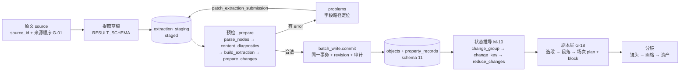

# 开发者手册

面向：要在这个仓库里加功能、改合同、排错的人。
概念与判断规则的唯一来源是[叙事模型](MODEL.md)（`M-01`…`M-16`）与[术语表](GLOSSARY.md)（`G-01`…`G-21`）；程序真正会拒绝的约束及其校验点见[数据不变量清单](INVARIANTS.md)（`I-01`…`I-33`）。本文只讲「代码怎么落地」。

配套阅读：`AGENTS.md`（协作与验收约定）、[提示词写作风格](PROMPT_STYLE.md)、[测试约定](TESTING.md)、[数据模型](data/DATA_MODEL.md)、[文档索引](README.md)。

## 1. 架构总览

依赖方向单向下沉，入口唯一：UI／CLI／MCP／agent → `Operations` → 门面与服务 → 预检与原子写 → 存储。下层不反向引用上层，UI、CLI 与 harness 一律经 `Operations` 进入业务能力（`AGENTS.md`「协作与架构」）。

| 域 | 职责 | 主要模块 | 依赖 |
| --- | --- | --- | --- |
| 项目入口 | 创建、打开、列出、复制工程；业务写入的唯一门面 | `operations.py`、`project_catalog.py`、`project_copy.py` | 向下调 `graph_operations.py` |
| 组合根 | 把各域能力装进一个对象，UI／CLI／工具都从这里拿 | `graph_operations.py`、`graph_facades.py` | 依赖全部服务域 |
| 存储与原子写 | SQLite 当前对象与属性记录；一次预检、一次提交、失败全回滚 | `graph_store.py`（schema 11）、`batch_write.py`、`temporal_state.py::persist` | 只依赖 `graph_store` |
| 提取 | 草稿解析、预检、暂存、逐层派生、事件合并 | `extraction.py`、`extraction_draft.py`、`extraction_staging.py`、`extraction_refs.py`、`extraction_containers.py`、`container_evidence.py`、`containment_refs.py`、`event_location.py`、`event_merge.py` | 依赖存储与属性合同 |
| 图与属性 | 结构校验、查询投影、属性定义与事件处变更、状态推导、分类与审计 | `graph_service.py`、`graph_models.py`、`graph_query.py`、`graph_views.py`、`property_core.py`、`property_store.py`、`property_categories.py`、`property_audit.py`、`node_material.py`、`browse_view.py` | 依赖存储 |
| 改编 | 与正式图独立、显式同步的改编工作区 | `adaptation_operations.py`、`adaptation_views.py`、`adaptation_state.py`、`adaptation_import.py` | 依赖图读取与存储 |
| 剧本层 `G-18` | 剧本 → 段落 → 场次（场表 `plan` + 正文块 `block`）、结构树、时间线副本、编译导出 | `screenplay_operations.py`、`screenplay_models.py`、`screenplay_structure.py`、`screenplay_timeline.py`、`screenplay_scene_policy.py`、`screenplay_writing.py`、`screenplay_compile.py` | 依赖图与存储 |
| 分镜 | 场的镜头与画格、机位、时长、资产元素、图片与视频（MODEL 之外的消费层） | `storyboard_operations.py`、`storyboard_panels.py`、`storyboard_camera.py`、`storyboard_timing.py`、`storyboard_assets.py`、`storyboard_art.py`、`storyboard_video.py` | 依赖存储与资产目录 |
| 内容与资产 | 业务内容的显式目录、暂存与局部修补、资产与素材 | `content_operations.py`、`content_errors.py`、`business_staging.py`、`asset_operations.py` | 依赖存储 |
| 对话与工具 | 常驻会话、模型接入、工具表、CLI／MCP 外壳 | `assistant.py`、`assistant_host.py`、`conversation_session.py`、`conversation_runtime.py`、`harness.py`、`model_gateway.py`、`messages_bridge.py`、`tool_api.py`、`tool_cli.py`、`mcp_server.py` | 依赖 `Operations` |
| 桌面 UI | Qt Quick 界面、桥对象、外观令牌 | `native_app.py`、`native_bridge.py`、`qml/*.qml`、`appearance.py`、`theme.py`、`qt_preflight.py` | 只经桥调用 `Operations` |
| 验收与审计 | 静态检查视图、诊断定位、写入摘要、用量统计 | `project_check.py`、`diagnostic_locations.py`、`task_write_summary.py`、`usage_statistics.py` | 只读 |

两条边界：

1. `data/` 与 `artifacts/` 是运行产物与历史验收目录，不是代码源；禁止从中导入或复制实现到 `src/`、`tests/`、`scripts/`（`AGENTS.md`「运行产物与历史代码边界」）。
2. 历史格式不回读：只维护当前 schema，旧工程直接拒绝打开，不做迁移或兼容分支（`AGENTS.md`「协作与架构」第 1 条）。

## 2. 环境与启动

- 解释器在仓库内的 `.venv`：命令用 `.venv\Scripts\python.exe`，GUI 用 `pythonw.exe`。venv 不完整时先 `uv sync --locked --all-extras`（`start-desktop.ps1` 的报错原文），或跑 `setup-environment.cmd`。
- 启动桌面：`pwsh -File start-desktop.ps1 -Project <工程.nproj>`；加 `-PrepareOnly` 只做启动自检不打开窗口（实测输出 `Project environment is ready.`），`-QaExitAfterSeconds N` 定时退出，`-RenderLog <相对路径>` 记录实际渲染后端。
- 默认套件不需要任何 GUI 变量：`pytest` 已按 `addopts` 排除 `ui`／`native`／`integration` 并开 `-n auto`。
- UI 用例一律离屏跑：`QT_QPA_PLATFORM=offscreen`、`QT_QUICK_BACKEND=software`；再用 `NARRATIVE_PROVIDER_DB` 指向临时库隔离 provider 配置（已实测：`pytest tests/test_lazy_pages_ui.py -m ui -n 0` → 4 passed）。
- 工程与临时产物都落在调用方给的路径（`tmp_path`、`artifacts/logs/`），不要写用户目录（`AGENTS.md`「运行产物与历史代码边界」）。

## 3. 数据流

一次提取的完整链路（编号对应下面各层）：

1. **原文**：`import_source` 写入 `sources` 与 `source_order`；先后坐标是「来源顺序 + Unicode 偏移」，不能用编号、录入时间或文件名代替。`G-01`、`I-32`
2. **草稿**：agent 调 `submit_extraction(source_id, result)`；`result` 的形状由 `RESULT_SCHEMA` 发布，字段枚举不在提示词里重复，其中 `type=event` 强制 `participants`。`I-08`
3. **暂存**：`extraction_staging.submit` 落一条 `staged` 记录（带 `submission_id`、`submission_revision`）。它还不是事实。`I-28`
4. **预检**：`extraction_draft._prepare` 依次做——`parse_nodes` 定位逐字引文、校验参与者与引用 → `content_diagnostics` 查结构边界 → `build_extraction` 生成节点与属性记录（含容器属性让位 `M-16`／`I-09`）→ `Operations.prepare_changes` 走 `batch_write.prepare`（图归一化、容器证据刷新、静态校验）。
5. **分流**：有 `error` 就保持 `staged`，回传带字段路径的 `problems`；用 `patch_extraction_submission` 局部修补后自动重检。只有 `error` 阻止入库。`I-28`、`I-27`
6. **入库**：`batch_write.commit` 在同一事务里写差异行、推进 `revision`、落操作摘要 → 状态为 `accepted`。失败整体回滚，不产生半份事实。`I-27`
7. **状态推导**：读的时候才算。`change_group` 分组、`change_key` 排序、`reduce_changes` 折叠出当前状态，不存有效期也不存状态表。`M-10`、`M-11`、`G-10`、`I-30`、`I-31`
8. **剧本层**：从已入库事件选段 → 段落 → 场次（一份场表 `plan` 加一串正文块 `block`）→ 确定性编译与导出；场次与正文块是可选的消费层，不写回提取层。`G-18`、`G-19`
9. **分镜层**：场 → 镜头 → 画格，加机位、时长、资产元素与图片／视频产出。这一层不在 `MODEL.md` 的概念里，细节见 `STORYBOARD_*` 专题。

两个入口的分工：`submit_extraction` 会自动入库；`preview_extraction` 只跑预检、不写事实，用于单独试查。

## 4. 常见任务怎么做

### 3.1 加一条属性校验

1. 判断它属于哪一层：值类型与字段形状 → `property_core.validate_records`；事件地点 → `event_location.event_location_issues`；图结构 → `graph_service.GraphService.normalize`／`precheck`。
2. 在那一层用该模块自带的 issue 构造函数追加（`_issue(CODE, 消息, object_id, severity=...)`），消息要能被模型直接改成操作，不写「请检查」。
3. 记下新码 `CODE`，并在[数据不变量清单](INVARIANTS.md)补一行（码／校验点／覆盖测试）：这份表是防漂移测试 `tests/test_doc_consistency.py` 的锚点，文档引用但 `src/` 搜不到的码会让它变红。
4. 写测试：优先纯函数直接构造 `records`／`snapshot` 断言 `code` 与 `object_id`；需要持久化时复制会话模板 `project_template`。
5. `ruff check src tests` + 针对性后台 `pytest -n 0`。

### 3.2 改一个提示词

1. 先读[提示词写作风格](PROMPT_STYLE.md)：五段结构、字数上限、「不能」≤5、概念定义必须在前 1/3。
2. 只改草稿正文 `artifacts/prompt-drafts/<key>.md`：头部 `version`／`label`／`description` + `---` 之后是正文。`system` 没有草稿文件，文本取自 `_recovered.json`。
3. 必须升 `version`（每条独立版本号）。
4. 跑 `.venv/Scripts/python.exe scripts/rebuild_prompt_defaults.py` 重建 `src/narrative/prompt_defaults.py`。脚本以 HEAD 为基线，**不要**手改生成物。
5. 同步断言（只改要点，不锁长句）→ `pytest -k prompt`；行为类提示词再做真实模型多次对照，记录写进 `docs/`。

### 3.3 加一个诊断码

1. 选层：草稿期在 `extraction_draft`（`DRAFT_SCHEMA`／`EXTRACTION_CONTENT`／`EXTRACTION_INFO`）；入库期在 `property_core`／`graph_service`／`event_location`／`containment_refs`。
2. 决定级别：`error` 阻止入库，`warning`／`info` 只提示。给「程序替用户做的决定」用 `info`（实例见 `I-09` 的 `CONTAINER_PROPERTY_DEDUP`），不要用 `error`。
3. 带上可修的位置：`path`（如 `['properties', i]` 这类草稿槽位）、`object_id`、必要时 `related_paths`；`extraction_staging._problems` 会把它们归一成 `targets` 与 `location`。
4. 测试断言 `code` + `path`，并确认非 error 的码不会让 `valid` 变假；新码同步写进[数据不变量清单](INVARIANTS.md)。

### 3.4 加一个 UI 页面

1. 新建 `src/narrative/qml/<Name>Page.qml`；页面自己持有状态、自己订阅桥对象，不在 `Main.qml` 里堆业务逻辑。
2. `Main.qml` 三处登记：`navItems` 加一项、`Component { id: ... }` 包页面、一个 `Loader` 用 `app.pageVisited(key)` 控制懒创建（第一次进入才实例化）。
3. 需要读写数据就在 `native_bridge.py` 暴露方法／属性，由桥调用 `Operations`；页面不直接碰数据库（`AGENTS.md`「协作与架构」）。
4. 测试：QML 用例走 offscreen + software 后端的 `workspace_shell` 写法，文件名带 `_ui` 或命中 `tests/conftest.py` 的标记规则，默认套件会跳过它。

## 5. 坑与取舍

**属性不存有效期。** 事实只有「事件处的变更」，当前状态是读时推导的结果。取舍：多了推导成本与冲突诊断，换来回退简单（按阅读位置删后续记录再重推）和「补录早先事实不变最新状态」。想表达失效就写 `clear`／`unknown`，不要加 `valid_from`。`M-07`、`G-09`、`I-19`

**容器属性让位。** 场景／大事件／主要故事本身可以写属性，但同一属性若与某个下属事件同组（主体除外其余全同），这条写入会被丢弃并回 `info`（`CONTAINER_PROPERTY_DEDUP`，附 `duplicate_of`）。取舍：容器值本来就来自下属事件（取最后有效值），两层各存一份会让同一事实被计两次；判断不出层级时宁可放过，不猜。`M-16`、`G-11`、`I-09`

**参与者必填但不设状态位。** 事件必须给 `participants`：有原文明示出场者就填引用，确无或未交代就给空数组。取舍：空数组本身就是「无」，不再新增「参与者未知」字段，避免多一个必须同步的状态；代价是空数组无法区分「没人」与「没写」。`I-08`

**提示词是数据。** 提示词进版本库、有 `version`、有断言、要真实模型对照。取舍：改措辞也算改合同，必须同步升版本与断言；换来的是行为可回溯、可回归（[提示词写作风格](PROMPT_STYLE.md#5-验收) §5、[修改流程](PROMPT_STYLE.md#6-修改流程) §6）。

**测试分四层。** 默认套件只回答「数据是否被正确读写、推导和拒绝」；Qt UI、真实 SDK／宿主、非数据集成分别用 `ui`／`native`／`integration` 标记，默认排除但保持可运行。取舍：默认套件保持分钟级并行，代价是 UI 与传输问题靠显式错误与人工冒烟发现（[测试约定](TESTING.md#分层)）。
