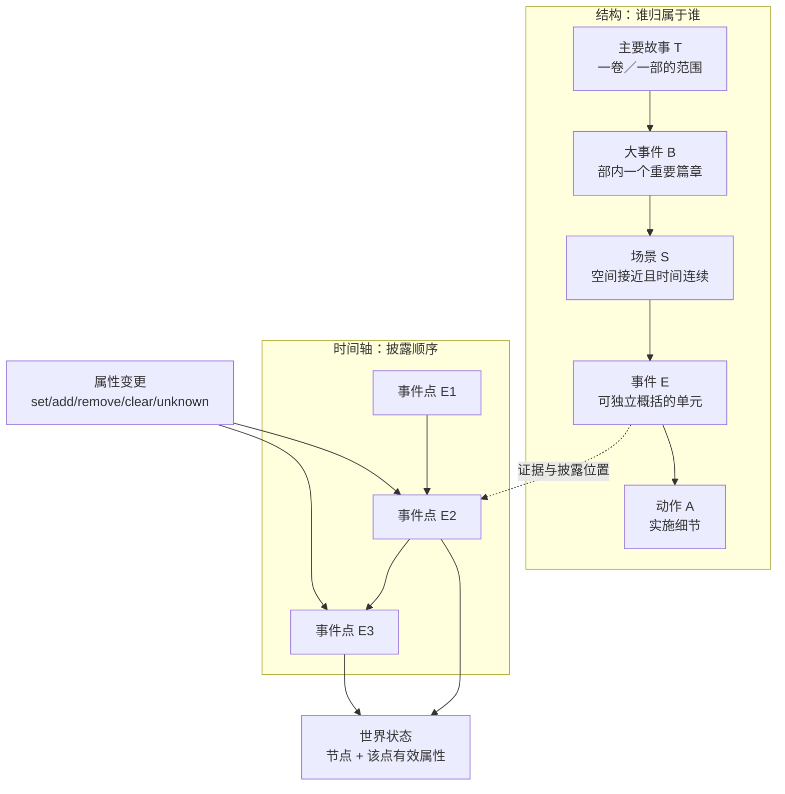
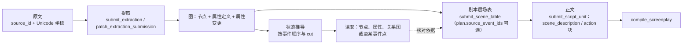

# 叙事模型

这份文档是项目里概念的唯一事实源：五层结构、属性与状态，以及它们之间的推导关系。代码、提示词与其它文档以此为准；发现不一致时先改这里。

读者是要让模型按规则工作的提示词作者、要判定期望行为的人，以及核对文档的开发者。每条判断都有稳定编号（`M-01`），可以被引用和检索。

## 1. 这是什么

三个基本量：

- **事件（E）**：时间轴上的一个点。原文按披露顺序给出这些点；`E1`、`E2` 只表达身份，不表达先后。
- **属性**：事件处的一次状态变更。定义（`property_definition`）说明这类属性是什么形状，变更（`property_change`）说明谁在哪个事件处变成什么。
- **世界状态**：某个事件点上「节点 + 有效属性」的快照。它不是一条记录，而是按事件顺序折叠变更得到的结果。

折叠一次只处理一组（主体、属性、语境、作用域、持有人），从最早的变更开始，同一事件内按 `sequence` 排。切点用事件或事件内序号指定，取该点及之前的变更，于是「读到第 40 个事件时某人的身份」有确定答案。

**为什么这样分**：叙事要能被回放。把状态做成覆盖式字段，就看不出第 5 个事件点上他还是学徒、第 40 个事件点已经出师；把变化平铺成日志而没有事件轴，就无法回答「读到该处时读者知道什么」。事件当坐标、变更当事实、状态当推导，三者分开才既保留历史、又对每个阅读位置给出确定答案。

### 五层各回答什么问题

| 层 | 类型 | 回答的问题 | 一句话定义 |
| --- | --- | --- | --- |
| 主要故事 | `storyline` / T | 这一卷／一部覆盖哪一段 | 一卷／一部的范围；条数不写死，可在进行中创建并持续修订 |
| 大事件 | `big_event` / B | 这一段里阶段换了吗 | 部／卷内一个重要篇章，同语境连续的一大段进展 |
| 场景 | `scene` / S | 现场还连续吗 | 一组空间上接近、时间上连续的事件的归纳，不承担地点身份 |
| 事件 | `event` / E | 能否独立概括 | 介于场景与动作之间、有自身起因与落点的情节单元 |
| 动作 | `action` / A | 这件事怎么做的 | 事件的实施细节，直属恰好一个同语境事件 |

场景不记地点：地点是事件的 `world` 属性，上层地点由成员事件集合派生。层级表达归属，不表达时间刻度；跨层比较先后一律看原文来源顺序与 Unicode 披露位置。

## 2. 怎么判断

每条一到两句，都可判定。前缀编号用于引用。

**结构与边界**

- `M-01` 事件的边界看能否独立概括成一个情节，以及拿掉它前后情节是否仍成立；段落、章节、句子数、动词数都不作判据。
- `M-02` 场景的边界看现场是否还连续：空间仍接近、事件仍连贯。同一地点但隔了很久，或同一时刻换到远处，另起一场。
- `M-03` 大事件的边界看阶段是否换了：同一语境下连续的一大段进展，按披露顺序首尾相接。
- `M-04` 主要故事的边界就是部／卷本身：一部一条或拆成多条都可以，未完结也能创建，完成度由程序从下级证据派生。
- `M-05` 动作只在明确要求时提取；它直属恰好一个同语境事件，是最小包含层级。
- `M-06` 章节标题、原文切片和提交批次只作阅读索引与处理范围，边界仍按 `M-01`–`M-03` 判断。

**状态与属性**

- `M-07` 属性变更只写在事件处，操作取 `set`／`add`／`remove`／`clear`／`unknown`；前三者带值，后两者不带。
- `M-08` `scope` 决定这是谁的事实：`world` 是客观世界，`cognition` 是人物所知所信，`claim` 是言说主张；后两者用 `holder` 标明持有者，不覆盖 `world` 的取值。
- `M-09` 人物标量关系按对方对象分别维护；`many` 只表示一个数组集合。移除一个对方不清空其他关系。读取时列出当前有效的全部值。
- `M-10` 状态的答案是折叠结果而不是最后一条记录：同一事件同 `sequence` 的相容变更合并，不相容报冲突，不按记录 ID 猜测。
- `M-11` 读取某个事件点时得到的是截至该点的状态（读工具的 `cut`），不是全篇终态。

**证据与纠错**

- `M-12` 每条事实的引文必须逐字命中原文；定位与唯一性由程序校验，模型不手算坐标。
- `M-13` 事件默认给一条能支持身份与核心发生的代表性引文；引文数量不决定事件边界，属性与关系各自取证。
- `M-14` 复核只修有据错漏：没再提及不等于失效，冲突或一次攻击也不等于终止；确认终止时保留建立事实，在终止事件追加 `remove`／`clear`。
- `M-15` 两个疑似重复的事件是否同一次发生，看原文证据是否一致，同名或位置相近不作依据；先 `preview_event_merge`，再 `merge_events`。
- `M-16` 容器属性若与某个下属事件的属性同组（主体除外其余全同），以事件记录为准，容器写入被丢弃并回一条 `info`。

## 3. 硬约定

以下条目都有真实校验，违反时返回诊断码或跳过原因。

**事件地点**：每个活动事件必须在自身事件处记录 `world` 地点，主体与 `at_event` 都指向该事件。

| 诊断码 | 触发 |
| --- | --- |
| `EVENT_LOCATION_REQUIRED` | 事件没有自己的 `world` 地点，或清空、移除后未重新记为无／未知 |
| `EVENT_LOCATION_ANCHOR` | 地点变更锚在别的事件上 |
| `EVENT_LOCATION_VALUE` | 值既不是同语境 `location` 节点，也不是显式的无／未知 |
| `EVENT_LOCATION_CONFLICT` | 同一事件点出现不相容的地点状态 |

**参与者与持有者**

- 事件草稿必须带 `participants` 键：`allOf` 对 `type=event` 强制 `required`，缺键返回 `EXTRACTION_CONTENT`。确无参与者或原文未交代时给空数组。
- 每个活动物品必须有 `world` 持有状态（节点引用、无、未知），缺失或清除不等于未知：`ITEM_HOLDER_REQUIRED`。

**结构与进展属性**

| 诊断码 | 触发 |
| --- | --- |
| `EVENT_SCENE` | 活动事件没有经包含路径属于同语境的活动场景 |
| `ACTION_EVENT` | 动作不是恰好直属一个同语境事件（直接挂场景或大事件） |
| `ACTION_LEAF` | 动作包含子项 |
| `STORYLINE_CHILD_TYPE` | 层级跳级，例如主要故事直属事件 |
| `STORYLINE_POSITION` | 容器没有可定位的直属成员，无法确定阅读起点 |
| `STORYLINE_OVERLAP` | 成员跨出已完成主要故事的区间，或与下一区间重叠 |
| `STORYLINE_COMPLETION` | 主要故事的完成边界缺失，或早于所属成员的起点 |

`storyline_progress` 写在直属大事件上，`big_event_progress` 写在直属场景上；写到更上层时该条写入被跳过（结果里的 `skipped` 附原因），程序不迁移旧层级。

**属性记录与状态推导**

- `property_change` 必带 `node_id`、`property_id`、`event_id`、`op`、`sequence`；`sequence` 由程序按引文起点生成，模型自带 `sequence` 会按 `DRAFT_SCHEMA` 拒收。
- 折叠失败码：`STATE_CONFLICT`（同事件同序号不相容）、`EVENT_ORDER`（变更缺少正式顺序）、`SEQUENCE`（序号非法）、`STATE_GROUP`（跨分组）、`VALUE`（关系值不是单一有效对方）。
- 证据问题用 `EVIDENCE`，草稿形状用 `DRAFT_SCHEMA`。

**暂存、入库与编号**

- 返回 `staged` 表示草稿只被暂存、未写入正式事实；修补用 `patch_extraction_submission`，`expected_revision` 填 `submission_revision`。通过后返回 `accepted` 或 `unchanged`。
- `info` 不是必须清零的错误：容器属性判重（`CONTAINER_PROPERTY_DEDUP`，附 `duplicate_of`）即 `info`。
- 本批引用 `@n` 从 1 起，数组索引从 0 起。
- 合并事件用 `source_event_id`（并入方）、`target_event_id`（保留方）、`expected_revision`、`evidence`、`reason`；合并后不保留重定向或旧修订对象。

### 数据流

场表与正文是可选的消费层：`source_event_ids` 不填不阻止写作；生成结束后程序区分 `used_event_ids`、`unused_event_ids`、`unknown_event_ids`，未绑定部分不冒充已使用。

## 另见

- 属性记录逐字段说明：[属性状态合同](data/PROPERTY_STATE_CONTRACT.md)
- 存储与包含关系：[数据模型](data/DATA_MODEL.md)
- 工具参数与返回：[工程工具与统一对话](features/AGENT_API.md)
- 提示词写法：[提示词写作风格](PROMPT_STYLE.md)
