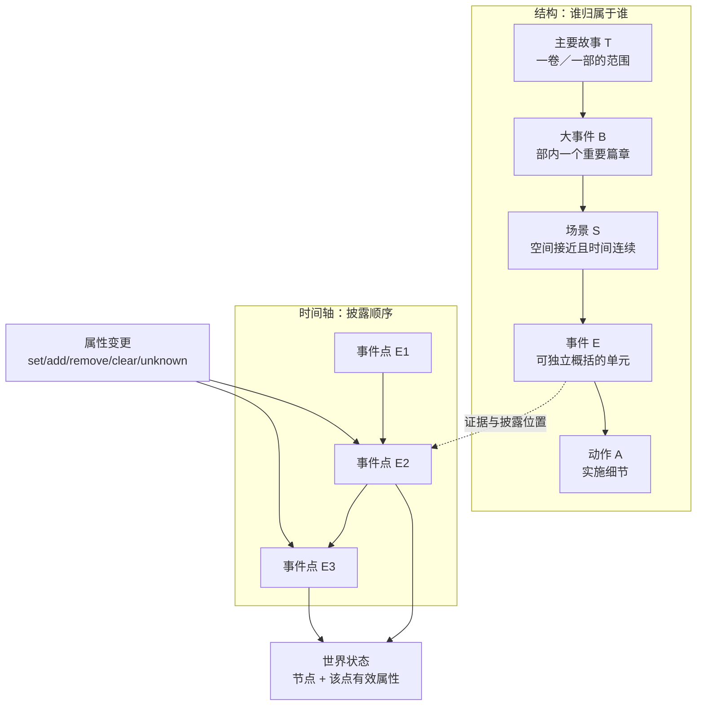

# 叙事模型

这份文档是项目里概念的唯一事实源：五层结构、属性与状态，以及它们之间的推导关系。代码、提示词与其它文档以此为准；发现不一致时先改这里。

读者是要让模型按规则工作的提示词作者、要判定期望行为的人，以及核对文档的开发者。每条判断都有稳定编号（`M-01`），可以被引用和检索。

## 1. 这是什么

三个基本量：

- **事件（E）**：时间轴上的一个点。原文按披露顺序给出这些点；`E1`、`E2` 只表达身份，不表达先后。
- **属性**：事件处的一次状态变更。定义（`property_definition`）说明这类属性是什么形状，变更（`property_change`）说明谁在哪个事件处变成什么。
- **世界状态**：某个事件点上「节点 + 有效属性」的快照。它不是一条记录，而是按事件顺序折叠变更得到的结果。

折叠一次只处理一组（主体、属性、语境、作用域、持有人），从最早的变更开始，同一事件内按 `sequence` 排。切点用事件或事件内序号指定，取该点及之前的变更，于是「读到第 40 个事件时某人的身份」有确定答案。

**为什么这样分**：叙事要能被回放。把状态做成覆盖式字段，就看不出第 5 个事件点上他还是学徒、第 40 个事件点已经出师；把变化平铺成日志而没有事件轴，就无法回答「读到该处时读者知道什么」。事件当坐标、变更当事实、状态当推导，三者分开才既保留历史、又对每个阅读位置给出确定答案。

### 五层各回答什么问题

| 层 | 类型 | 回答的问题 | 一句话定义 |
| --- | --- | --- | --- |
| 主要故事 | `storyline` / T | 这一卷／一部覆盖哪一段 | 一卷／一部的范围；条数不写死，可在进行中创建并持续修订 |
| 大事件 | `big_event` / B | 这一段里阶段换了吗 | 部／卷内一个重要篇章，同语境连续的一大段进展 |
| 场景 | `scene` / S | 现场还连续吗 | 一组空间上接近、时间上连续的事件的归纳，不承担地点身份 |
| 事件 | `event` / E | 能否独立概括 | 介于场景与动作之间、有自身起因与落点的情节单元 |
| 动作 | `action` / A | 这件事怎么做的 | 事件的实施细节，直属恰好一个同语境事件 |

场景不记地点：地点是事件的 `world` 属性，上层地点由成员事件集合派生。层级表达归属，不表达时间刻度；跨层比较先后一律看原文来源顺序与 Unicode 披露位置。

判断规则与硬约定已迁至 `docs/extraction/SPEC.md`，本页只保留概念。

## 2. 规则索引

按下表跳到 `docs/extraction/SPEC.md` 的对应小节；编号不变，引用方式仍是「编号 + 结论」。

| 内容 | 去哪找 |
| --- | --- |
| 模型判断规则 `M-01`–`M-16`（结构与边界／状态与属性／证据与纠错） | [SPEC 第 4 节](extraction/SPEC.md#4-模型判断规则m-xx) |
| 硬约定（事件地点、参与者与持有者、结构与进展属性、属性记录与状态推导、暂存入库与编号） | [SPEC 第 5 节](extraction/SPEC.md#5-程序强制i-xx与属性状态合同) |
| 诊断码（`EVENT_LOCATION_*`、`EVENT_SCENE`、`STORYLINE_*`、`STATE_*` 等） | [SPEC 第 5 节「硬校验」表](extraction/SPEC.md#硬校验) |
| 不变量 `I-01`–`I-33`（校验点、码、覆盖测试） | [SPEC 第 5 节](extraction/SPEC.md#5-程序强制i-xx与属性状态合同) |
| 属性状态合同、属性分类（schema 11） | [SPEC 第 5 节](extraction/SPEC.md#属性状态合同schema-11) |
| 提示词要求但程序不校验的约束 | [SPEC 第 5 节「仅提示词约束」](extraction/SPEC.md#仅提示词约束未程序强制靠验收与复核) |
| 数据流 | [SPEC 第 5 节「数据流」](extraction/SPEC.md#数据流) |
| 模型职责（`E-xx`）、诊断码总表、提示词索引 | [SPEC 第 3 节](extraction/SPEC.md#3-模型职责e-xx)、[第 6 节](extraction/SPEC.md#6-诊断码总表)、[第 7 节](extraction/SPEC.md#7-提示词索引) |

## 另见

- 属性记录逐字段说明：[属性状态合同](extraction/SPEC.md#属性状态合同schema-11)
- 存储与包含关系：[数据模型](data/DATA_MODEL.md)
- 工具参数与返回：[工程工具与统一对话](features/AGENT_API.md)
- 提示词写法：[提示词写作风格](PROMPT_STYLE.md)
