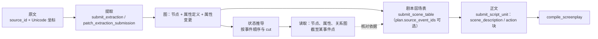

# 提取任务规范

提取任务的唯一规范页：模型该判什么（§4）、程序会拒绝什么（§5）、诊断码去哪查（§6）、
提示词怎么对应（§7）。搬运自 `docs/INVARIANTS.md`、`docs/data/PROPERTY_STATE_CONTRACT.md`、
`docs/data/PROPERTY_CATEGORIES.md` 与 `docs/MODEL.md` 第 2、3 节；措辞保持原文。

## 0 权威边界与变更纪律

- 本页是提取任务的唯一规范。概念定义以 `docs/MODEL.md` 为准，术语以 `docs/GLOSSARY.md` 为准，工具参数以 `docs/features/AGENT_API.md` 为准，三者不重复本文的规则条文。
- 编号：`M-xx` 模型判断规则、`E-xx` 提示词规范化出的硬约束、`I-xx` 程序强制的不变量、`G-xx` 术语。引用一律「编号 + 结论」。
- 改提取（提示词 / 校验 / 工具 / 诊断码）必须同批更新本页对应条目与 §7 的提示词版本表；`tests/test_extraction_spec.py` 会拦。
- **提取正确性不由程序判断**。程序只回答"这条记录在结构上成不成立"：引文是否逐字对齐原文、证据是否落在本次范围、引用与包含是否合法、写入是否原子、修订号是否一致。事件切得对不对、漏没漏人、粒度是否合适，只有人和模型对照原文才能判。所以：程序不设"覆盖配额""事件密度""正确率"，验收脚本只报结构结论与测量值（`report.json` 的 `structural_checks` 对 `measurements`），最终结论固定为待人工判定。

### 0.1 留白与用户裁定

提示词不是越细越好：把概念讲清楚、边界交给语义判断，比枚举所有情况更稳——穷举一定会漏，而且会互相冲突。所以本页只写可判定的约束，判不出来的**有意留白**，不补机械判据。下面这些是用户明确裁定过的口径，优先级高于任何一处提示词措辞：

| 编号 | 问题 | 裁定 |
| --- | --- | --- |
| `U-01` | 一次「交涉／选择／转折」算不算独立事件 | 以 §4 `M-01` 为准（事件不是动作 ＋ 层级之间是粒度差）；「有自身展开就可独立成事件」只是提示别漏判，**不是充分条件**（`granularity_fine` 自己写着"这是判断说明"）。 |
| `U-02` | 复核时勘误怎么改 | **直接改那条记录**（`correct_property` / `delete_property_records`，或节点层面的既有更正工具）。**禁止**追加一条「修正记录」或「解释性变更」——数据就是数据库条目，堆修正记录是屎山。也不把录入错误写成故事失效（`E-28`）。 |
| `U-03` | 复核做哪几件事 | 查漏、补缺、勘误（`review` v13）。已成立事实后来变化或终止，按后文证据补上变更记录，这属于「补缺」，不是第四件事。 |
| `U-04` | 关系方向与反向记录 | 按关系语义判断：**互逆关系**（父子、师生）正反两条都要记——A 是 B 的父亲，B 就是 A 的孩子；**单向关系**（喜欢、信任）只记有原文依据的方向；`symmetric` 只表示同一个值对称成立，不负责反向（`E-27`）。 |
| `U-05` | 精细级要不要给配角建档 | 要。精细级面向改编：**出场人物都要建档**：建人物节点并写清能支撑造型的属性，**提取阶段不建资料卡**；视觉资产据此建立。次要、无名同样建档，不按主线重要性筛除（`E-17`）。 |
| `U-06` | 「明确指定」「实质进展」「清晰概括名」这类没有判定口径的措辞 | 有意留白，不写机械判据，靠模型判断与人工复核（`E-01`–`E-03`、`E-30` 一类只写方向不写阈值）。 |
| `U-07` | 属性名能不能就是分类名 | **可以，而且鼓励**：属性名恰好是分类词表里的一项时，它自然就属于这一类（`category_source=identity`），不必为分类另造名字，也不报错、不拦。一个类下允许并列多条属性（外貌 → 身高、发型、瞳色）。 |
| `U-08` | 同一属性被多次提及时，前面几条算不算数、什么时候才并列 | **同一属性：后一次提及让前一次失效**——这是状态型，`cardinality` 语义不变，后写覆盖前值；所以「矮小黝黑」在改造事件被新描述取代后就是历史，读取当前值只有新的那条。**并列只发生在两处**：① 同一事件点里**同时成立**的多个值 → 一条记录装多值数组（`many`）；② 同一类别下的**不同方面**是不同属性名（身高、发型、瞳色各一条），它们本来就不会互相覆盖。**不要**为了"保留旧描述"把先后关系写成并列；要看旧值去历史／节点编辑器。规范只写这两条，**不枚举属性名单**（`E-22`）。 |

| `U-09` | 哪些对象必须自带原文位置、哪些靠事件定位 | **只有事件需要定位依据**：`anchor{start,end}`（原文 Unicode 偏移，推荐）或一条逐字 `quotes`，二者至少一个。**其它节点与属性不填引文（写了也是多余参数：程序丢弃并回一条 `info`，`U-10`）**。理由是这一句：**每个节点、每个属性都以事件为基础；事件是时间点，事件链是时间轴**。所以实体的出处就是它挂靠的那个事件——人物／群体出现在事件的 `participants`，地点是事件发生处的 `world` 地点取值，物品在事件处易手，属性以 `at_event` 指向事件，场景／大事件／主要故事由下级包含，动作直属一个事件。实体的阅读位置＝**它最早挂靠的那个事件的位置**（程序按此派生 `evidence`／`disclosure`，形状与逐字引文完全一致）；提取按披露顺序进行，事件点就是披露时间轴，任何实体都必能挂在某个事件上，因此不存在"没有落点的实体"。不要把"没有引文的节点"当成缺证据。 |
| `U-10` | 草稿里带了不该带的字段，要不要为它整批拒收 | **无效参数只丢弃，然后提醒**。**多余**的东西不影响理解：不该带的字段（非事件的 `quotes`、属性上的 `quotes`／`anchor`、场景／大事件／主要故事的 `quotes`）、没有意义的冗余写法、不认的未知字段，一律从草稿里剥掉，同类 `(section, field)` 折叠成一条 `info`（`count` 是处数、`indexes` 指出涉及条目，最多列 12 个），**能理解的部分照常入库**。**只有"看不懂"的输入才拒收**：缺必填、类型不对、引用解析不到、事件没有定位依据。判据就是这一句：**多余不影响理解，缺失才影响理解**。剥完以后一行里已经没有有效内容的（例如只给了 `quotes` 的人物），按缺必填拒收，不静默丢成空节点（`E-09`、`E-13`、`I-08`、`I-10`、`I-13`）。 |
| `U-11` | 模型给的引文和原文只差一个标点／空格／全半角，要不要整批拒收 | **不要：定位是程序的事，逐字是对存储结果的硬要求，不是对模型输入的措辞要求**。程序先逐字找；不中就把引文与原文做**同一套归一化**，在本批范围再找一次——归一化只抹**排版差别**：全半角与兼容写法按 NFKC 统一（`，`→`,`, `Ａ`→`A`、`１２`→`12`）、空白与不可见字符（零宽、控制符、行／段分隔）不参与比对、标点不参与比对（连续几处折成零处；换一个、少一个、多一个都不算改内容）。**文字一个都不抹**：差一个汉字／字母／数字（`狠狠地`→`狠地`、`匕首`→`短刀`、`第12号`→`第13号`）仍然定位不到——那是另一个词，不是排版，宁可丢弃也不把证据写成错的。归一化后**唯一命中**：用原文截取到的逐字文本与真实坐标，`evidence.quote` 因此**不是**模型给的那一串；归一化后**多处命中**：仍拒收，回候选起点（`positions_sample`，另给 `related_paths` 指向该行的 `anchor`——写坐标就没有歧义）；归一化后**找不到**：丢弃这条引文、**事件照常入库**，位置近似取本批范围起点，回一条折叠后的 `info`（`EXTRACTION_INFO`：`count` 是处数、`indexes` 是涉及条目）说明丢了几条。`anchor` 路径不变（本来精确）。判据一句话：**像排版差异就校正，像内容差异就丢弃，两种都不回退整批**（`M-12`、`E-13`、`I-13`）。 |

| `U-12` | 五层事件节点能写哪些属性名 | **只有 T／B／S／E／A 受白名单约束，人物／物品／地点／群体继续自由命名**。白名单是每层一张小表：主要故事 T＝「下属大事件」「名称」；大事件 B＝「下属场景」「名称」；场景 S＝「下属事件」「名称」；事件 E＝「地点」「参与者」「锚点」「名称」；动作 A＝「所属事件」「名称」。表外属性名按 `U-10` 口径**丢弃该条属性 + 一条折叠 `info`**（消息里列出该层允许的名字），不整批拒收；分类由表自动带出（「名称」归「基本信息」），模型写的 `category` 与表不符**以表为准**并回一条 `info`。`地点` 必须保留程序生成路径：事件地点快捷字段生成的那批地点属性行不受白名单拦截（实测一章就有 77 条）。白名单实现在 `src/narrative/property_vocabulary.py`，与分类词表同一套存储方式存在工程配置里，可改（`E-25`、`I-11`）。 |
| `U-13` | 节点的名字是不是身份 | **编号是身份，名字是属性**。节点身份＝系统分配的编号（`P7`／`E3`）：不可变、不重编、跨类型不可比。名字只是**一条属性**（`名称`）：建节点时 `node.name` 就是第一条「名称」的值（初始值），之后改名写一条新的「名称」，**旧名失效、新名生效**（沿用现有状态折叠：`set` 取代前值，旧名不并列）。`node.name` 因此降级为**初始值**，界面与导出显示**当前生效的名字**（截至阅读位置的最后一条「名称」，无变更时回落到 `name`）；大事件与主要故事的「进展」就是当前生效的名字，**不设「进展」属性**——`storyline_progress`／`big_event_progress` 两个属性名已删除。事件上模型自写的状态属性（`状态`／`载知内容`／`持有者`／`题字`）会被白名单丢弃：**状态属于实体，事件只是它的时间点**。名字不是容器对下属事件的归纳，所以不参与容器属性判重（`I-09` 对「名称」不适用）。 |

锚定关系（谁靠什么挂在事件上；这张表就是 `U-09` 的可核对照）：

| 对象 | 在事件链上的落点 |
| --- | --- |
| 事件 | 唯一自带原文位置的对象：`anchor` 或逐字引文（`M-13`） |
| 人物／群体 | 作为某事件的 `participants` 出现 |
| 地点 | 某事件的 `world` 地点取值（其次：某条属性变更在事件处指向它） |
| 物品 | 某事件处的持有者变更（其次：某条属性变更在事件处指向它） |
| 属性（`property_change`） | `at_event` 指向的那个事件：披露位置与证据都取该事件的（`I-18`） |
| 动作 | 直属事件的披露位置（`M-05`） |
| 场景／大事件／主要故事 | 下级容器／事件包含，证据由 `src/narrative/container_evidence.py::validated_spans` 逐层派生（`I-10`） |

到 2026-11 为止，`U-01`–`U-05`、`U-07`、`U-08`、`U-09`、`U-10`、`U-12` 与 `U-13` 已落进提示词（`extraction` v41、`granularity_fine` v12、`review` v13），`U-06` 永远留在「仅提示词」一侧；`U-11` 只落在**程序侧**（定位与存储），提示词不加判据——模型该做的还是照原文写，宽容是程序的事。

## 1 范围、引用与批次

- 范围：原文是唯一事实来源；事件必须给定位依据（`anchor` 或逐字引文），引文的逐字与唯一由程序落实——只差排版时归一化校正，差实词就丢弃那条引文（`U-11`、`I-13`、`M-13`）；章节标题、原文切片和提交批次只作阅读索引与处理范围，不决定场景或事件边界（`M-06`）。来源：本页 §4（原 `docs/MODEL.md` 第 2 节）与提取提示词「提取通用要求」v35。
- 引用：本页与其它文档一律按「编号 + 结论」引用（§0），编号集合与出处见 `docs/README.md`；五层概念见 `docs/MODEL.md` 第 1 节。
- 批次：一小批一次提交；本批引用写名称或正式 ID，数组索引从 0 起（见 §5「暂存、入库与编号」）；局部修补用 `patch_extraction_submission`（`I-28`）。

## 2 流程（读 → 提交 → staged → patch → accepted → 静态检查）

1. 读：agent 读取原文，原文是唯一事实来源（`I-13`、`I-16`）。来源：`docs/DEVELOPER_GUIDE.md` 第 3 节第 1 步。
2. 提交：`submit_extraction(source_id, result)`，草稿形状由 `RESULT_SCHEMA` 发布（`I-08`）。来源：同上第 2 步。
3. `staged`：草稿只被暂存，不是正式事实（`I-28`）。来源：同上第 3 步。
4. `patch`：`patch_extraction_submission` 局部修补，`expected_revision` 填 `submission_revision`，程序自动重检（`I-28`）。来源：同上第 5 步。
5. `accepted`：过检即原子入库，失败整体回滚（`I-27`）。来源：同上第 6 步。
6. 静态检查：入库后的自查由 `project_check` 提供（见 `docs/DEVELOPER_GUIDE.md` 第 1 节「验收与审计」）；状态推导在读取时发生（`I-30`、`I-31`，同上第 3 节第 7 步）。

## 3 模型职责（E-xx）

本节的每一条都是从 `src/narrative/prompt_defaults.py` 的 `DEFAULT_PROMPTS` 条目里规范化出来的**可判定祈使句**，只写「模型侧该怎么做」。同一约束不写两遍：程序怎么拒绝的细节只在 §5（本节「程序」列只给 `I-xx` 编号），判断口径见 §4 的 `M-xx`。四要素固定为：一条祈使句规则、一句最短原文出处、程序位置、一句最短反例。

- 出处格式：`条目 id` + `版本` + 一句逐字原文；版本与 §7 的提示词索引、与代码运行时三处必须一致（`tests/test_extraction_spec.py` 会拦）。
- 「程序」写 `仅提示词，无校验` 时，表示只能靠模型自检、真实模型验收与人工复核，不能当成已校验的保证；括注里的 `互查 M-xx`／`I-xx` 是模型判断层与程序强制层的互查入口。

### 3.1 通用工作原则（`system`）

- `E-01` 不得把未成功的工具调用报告成已完成。
  - 出处：`system` v11 ·「工具未成功的操作不得声称已完成」
  - 程序：仅提示词，无校验；互查 `M-12`（结论同样要能指回真实记录）
  - 反例：`submit_extraction` 返回 `staged`，回复里写「本批已全部入库」。
- `E-02` 判定关系或状态失效必须有原文依据：冲突、一次攻击、未再提及都不算失效证据。
  - 出处：`system` v11 ·「冲突、攻击或未再提及不自动等于失效」
  - 程序：仅提示词，无校验；互查 `M-14`
  - 反例：后文没再提师徒关系，就直接追加一条 `remove`。
- `E-03` 只为本次目标写数据：不为清零 `info`、不为采纳建议而增写事实。
  - 出处：`system` v11 ·「不为清零info或建议开启审核循环」
  - 程序：`I-09`（容器属性判重只回 `info`，它不是必须填的缺口）
  - 反例：为了让 `info` 归零，给容器补一条与下属事件同组的属性。
- `E-04` 保存走暂存修补：`staged` 时按问题路径用一次 patch 修多个问题，不重发整稿；`accepted`／`unchanged` 且无 error 才算入库完成。
  - 出处：`system` v11 ·「不重发整稿、不开人工审批」
  - 程序：`I-28`
  - 反例：`staged` 后原样重发同一批 `submit_extraction`。

### 3.2 边界与粒度（`extraction`、`granularity_standard`、`granularity_fine`）

- `E-05` 事件边界按粒度差判断：动作是事件里的一步（一句话、一个动作）；事件里分得出「怎么做的」若干步；场景装得下相邻的事件（只含一个事件也成立）；大事件是阶段级；主要故事是部／卷级。五层本质上都是「事件」，只是粒度等级不同，粗的一级装得下细的一级的若干条（装一条也成立），不把粗的一级写成细的一级的粒度。不按段落、章节、句子数、动作数或任何配额切分。放进上一层或下一层都说得通，说明它还没被定层。
  - 出处：`granularity_standard` v7 ·「边界靠语义判断，不设事件数或比例配额」
  - 程序：仅提示词，无校验；互查 `M-01`
  - 反例：按「一段一个事件」把一场铺陈切成 6 个事件；或把「他推门进来」单独立成一个事件（它只是一步动作）。
- `E-06` 场景边界按「空间、时间接近」判断：一组空间与时间接近的事件就是一个场景，只含一个事件也成立；地点不记在场景上，只记在事件上。
  - 出处：`extraction` v41 ·「空间、时间接近的一组事件；只含一个也成立」
  - 程序：仅提示词，无校验；互查 `M-02`
  - 反例：把「三天后，同一间屋子」并进前一场；或给场景单独记一条地点属性。
- `E-07` 大事件边界按「部／卷内的一大段故事」判断，按披露顺序首尾相接；它在不同时间点可以有不同的有效值（同一部未完也可持续修订）。
  - 出处：`extraction` v41 ·「部／卷内的一大段故事。随着披露，它在不同时间点可以有不同的有效值」
  - 程序：仅提示词，无校验；互查 `M-03`
  - 反例：阶段没换，只因为换了地点就给这一段新建大事件。
- `E-08` 章节标题、原文切片与提交批次只作阅读索引与处理范围，不用来切场景或事件的边界。
  - 出处：`extraction` v41 ·「不是场景或事件的边界」
  - 程序：仅提示词，无校验；互查 `M-06`
  - 反例：章末的停顿就收尾一个事件，换章处再开一个新事件。
- `E-09` 事件必须给定位依据：原文位置锚点 `anchor{start,end}`（推荐，程序按偏移截取逐字原文）或一条代表性逐字引文，二者至少一个；其它节点与属性不填引文，也不为凑证据回抄原文（`U-09`）；写多了只丢弃并回一条折叠后的 `info`，不整批拒收（`U-10`）。
  - 出处：`extraction` v41 ·「事件必须给定位依据：原文位置锚点」
  - 程序：`I-13`（给了引文才校验逐字与唯一，不限条数）、`DRAFT_SCHEMA`（事件两者都没有则拒收）、`EXTRACTION_INFO`（多余引文被丢弃）；互查 `M-13`
  - 反例：给人物和地点补一段引文（只会被丢弃，不会被采纳成证据），事件反而只写个名字；或一个事件挂「起因」「经过」「结果」三条引文。
- `E-10` 容器（T／B／S）不填定位依据，上层证据与阅读起点由程序从下级已验证证据逐层派生；模型只判边界、名称与直属关系。
  - 出处：`extraction` v41 ·「容器（T／B／S）不填定位依据」
  - 程序：`I-10`（容器不落自身 `quotes`）
  - 反例：给场景手写一条 `quotes` 想证明它存在。
- `E-11` 主要故事的完成边界取下级证据派生的 `completion`，不以章节结束或批次交完代替语义闭合；该部未完结也可创建并持续修订。
  - 出处：`extraction` v41 ·「该部未完结也可创建并持续修订」
  - 程序：`I-33`；互查 `M-04`
  - 反例：读完第 3 卷就把 T 的完成点定在第 3 卷末章。
- `E-12` 动作默认不提取：只在用户明确要求时创建，且不把动作改标成事件。
  - 出处：`granularity_fine` v12 ·「动作默认不提取；确需时由用户明确要求，也不把动作改标成事件」
  - 程序：`I-23`；互查 `M-05`
  - 反例：把「他推门进来」从事件里摘出来，单独建一个 `event`。

### 3.3 范围与复用（`source_extraction`、`extraction`）

- `E-13` 引文必须落在本次提交范围内（Unicode 字符，左闭右开）；范围外可读，但引文不出范围。逐字与定位由程序落实（`U-11`）：只差排版（全半角／空白／不可见字符／标点）时程序归一化后校正、存原文截取文本；差实词就丢弃那条引文，事件照常入库。事件用 `anchor` 时锚点同样必须落在本批范围内。范围之外的多余字段不算范围问题：丢弃后照常校验（`U-10`）。
  - 出处：`source_extraction` v9 ·「每条引文必须逐字落在范围内」
  - 程序：`I-16`、`DRAFT_SCHEMA`（`anchor` 越界或不在本批范围）、`EXTRACTION_INFO`（范围以外的多余字段、定位不到的引文只丢弃）；互查 `M-12`
  - 反例：为补前情，把范围外上一段的句子当作本批证据提交。
- `E-14` 拿不准的事实放进 `uncertainties`，不补默认值、不猜原文没交代的属性。
  - 出处：`extraction` v41 ·「拿不准放进 uncertainties，不补默认值」
  - 程序：仅提示词，无校验；互查 `M-08`（未提及就留白）
  - 反例：原文没写年龄，按常识填「二十岁」。
- `E-15` 按语境与引用依赖分批提交，一批语义完整就交，不攒成一份大草稿。
  - 出处：`source_extraction` v9 ·「按语境与引用依赖分批提交，一批语义完整就交」
  - 程序：`I-28`
  - 反例：把整章读完再一次提交 300 个节点。
- `E-16` 跨批复用已有对象时一律指向同一个已有 ID，不重复建同义节点。
  - 出处：`extraction` v41 ·「原文里同一个人物、地点、物品、事件就是同一个」
  - 程序：仅提示词，无校验（`ID` 只管记录 ID 唯一）；互查 `M-15`
  - 反例：上一批已给 `P1`，这一批又给同一人物新建 `P7`。

### 3.4 实体与地点（`granularity_fine`、`extraction`）

- `E-17` 精细级面向改编：**出场人物都要建档**：建人物节点并写清能支撑造型的属性（**提取阶段不建资料卡**），视觉资产据此建立；原文明示出场或实际起作用的次要人物、无名人物与具体地点同样核对建档，不按主线重要性筛除（`U-05`）。
  - 出处：`granularity_fine` v12 ·「精细档面向改编，出场人物都要建档」
  - 程序：`I-25`（只校验参与者节点类型与引用有效性）；视觉资产属改编消费层，不在此校验
  - 反例：只写主要人物，无名摊贩与「东街」都不登记，改编时建不出造型。
- `E-18` 无法区分的泛称与同一对象的重复提及不拆成新实体；身份不明记「未知」，不臆造身份。
  - 出处：`granularity_fine` v12 ·「身份不明记「未知」，不臆造身份」
  - 程序：仅提示词，无校验；互查 `M-15`（同名与位置相近不作依据）
  - 反例：两个「老人」被拆成两个人物节点，各写一段身世。
- `E-19` 每个活动物品都在事件处记 `world` 持有者状态（节点引用、「无」或「未知」）；清除、遗漏与认知记录都不能代替未知。
  - 出处：`extraction` v41 ·「每个活动物品都要有明确的持有者状态」
  - 程序：`I-05`
  - 反例：物品最后一次出现后留空，事后再解释成「不知道在谁手里」。
- `E-20` 每个事件都在自身事件处记 `world` 地点（`either` 节点引用或显式「无」「未知」）；场景不记地点，上层地点与认知都不能代替。
  - 出处：`extraction` v41 ·「场景不记地点，只有事件自身的 world 地点有效」
  - 程序：`I-01`、`I-03`
  - 反例：地点写在所属场景上，事件自己留空。

### 3.5 属性与状态（`extraction`）

- `E-21` 属性变更只写在事件处：`set`／`add`／`remove` 带 `value`，`clear`／`unknown` 不带，`at_event` 指向该事件自身。
  - 出处：`extraction` v41 ·「属性变更：set/add/remove 带 value，clear/unknown 不带」
  - 程序：`I-19`、`I-18`
  - 反例：用 `clear` 外加一个空的 `value` 数组表示清空。
- `E-22` `cardinality` 只约束录入：`one` 在同一事件点只允许一个当前值（多个对方就是多条记录），`many` 才把多项装在同一条记录里；读取一律返回全部当前有效值。同一方面后写覆盖前值：同一属性的后一次提及让前一次失效，前面几条只作历史；并列只在「同一事件点同时成立（`many` 一条记录多值）」与「同一类别下的不同方面（不同属性名）」两处（`U-08`）。
  - 出处：`extraction` v41 ·「同一属性以最后一次提及为准：后来的值是取代前值，前面的只作历史保留」
  - 程序：`I-20`；互查 `M-09`
  - 反例：把「师父」改成 `many` 来容纳柯镇恶与洪七公；或把一个属性的先后变化写成多条并列，让「矮小黝黑」与后来的外貌同时生效。
- `E-23` 认知与主张只在事件里明确追加时才写，值优先用对象引用；世界事实变化不自动改写认知。
  - 出处：`extraction` v41 ·「世界事实变化不自动改写角色认知」
  - 程序：`I-12`；互查 `M-08`
  - 反例：主角得知真相后，回头把全篇所有人物的旧认知批量改成新认知。
- `E-24` 每条属性变更给出该节点类型分类表里的一个大类，或显式写「未分类」；一个类下允许并列多条属性，属性名直接取分类名也完全可以（自然归入该类，`U-07`）；拿不准分类就写「未分类」，不硬凑。
  - 出处：`extraction` v41 ·「拿不准就写「未分类」，不硬凑」
  - 程序：无专属 `I-xx`（`category` 是草稿必填项，见 §5「属性分类」）；互查 `M-07`
  - 反例：把「身高」硬塞进「外貌」只为填满这一格。
- `E-25` 事件类节点（T／B／S／E／A）的属性名从工具给出的白名单里取，不自己造；状态属于实体，事件只是它的时间点；名字变了就在事件处记「名称」，编号不动（`U-12`、`U-13`）。
  - 出处：`extraction` v41 ·「事件类节点（T／B／S／E／A）的属性名从工具给出的白名单里取，不自己造」
  - 程序：`I-11`（白名单，表外名字丢弃并回折叠 `info`；分类由表带出）
  - 反例：在事件上写「状态」「持有者」「题字」——那是实体的属性；或为了改名新建一个节点。
- `E-26` 容器属性与某个下属事件同组时以事件记录为准：容器写入被丢弃并回 `info`，不换近义属性名重试。
  - 出处：`extraction` v41 ·「写入按判重规则丢弃并给 info」
  - 程序：`I-09`；互查 `M-16`
  - 反例：换个近义属性名，把同一条状态再写进容器。
- `E-27` 属性名描述取值相对节点的身份、关系或作用。方向按语义核对：互逆关系（父子、师生）正反两条都要记——A 是 B 的父亲，B 就是 A 的孩子；单向关系（喜欢、信任）只记有原文依据的方向；`symmetric` 只表示同一个值对称成立，不负责反向（`U-04`）。先查已有定义再新增，定义冲突时定向读取或显式更正，不换近义名绕过。
  - 出处：`extraction` v41 ·「互逆关系（父子、师生）正反两条都要记」
  - 程序：`I-20`（`symmetric` 为严格布尔）
  - 反例：A 是 B 的父亲，只记这一条、不给 B 记「孩子」；或反过来，凭「喜欢」猜对方也喜欢。

### 3.6 复核、合并与动作（`review`、`event_merge_review`、`action_extraction`、`conversation_actions`）

- `E-28` 复核做三件事：查漏、补缺、勘误。只修有据错漏，拿不准就保留并记存疑；勘误**直接改那条记录**（不追加「修正记录」），也不把录入错误写成故事失效；原已成立而后终止的，保留建立事实，在有证据的终止事件追加 `remove`／`clear`（`U-02`、`U-03`）。
  - 出处：`review` v13 ·「直接改这条记录；不追加「修正记录」」
  - 程序：仅提示词，无校验；互查 `M-14`
  - 反例：为了「改正」一条错录的取值，追加一条说明「上一条写错了」的变更记录。
- `E-29` 沿人物与事件角色查漏（身份、社会隶属、交往、临时作用分别核对），不只检查已经存在的关系；一次行为不升级为长期关系。
  - 出处：`review` v13 ·「沿人物和事件角色查漏，而不是只检查已经存在的关系」
  - 程序：仅提示词，无校验；互查 `I-25`（一次行为只作事件参与者事实）
  - 反例：把「他替她挡了一刀」写成两人之间永久的「保护者」状态。
- `E-30` 单方所信或声称写成 `cognition`／`claim` 并带 `holder`，不写成双方的 `world` 事实。
  - 出处：`review` v13 ·「单方认知不等于双方世界事实」
  - 程序：`I-12`；互查 `M-08`
  - 反例：甲相信乙是叛徒，就写一条 `world` 的「乙是叛徒」。
- `E-31` 合并先 `preview_event_merge` 看预检、再 `merge_events` 写入，两者同参 `source_event_id`／`target_event_id`／`expected_revision`／`evidence`／`reason`。
  - 出处：`event_merge_review` v3 ·「preview_event_merge 先看预检，merge_events 再写入」
  - 程序：仅提示词，无校验（字段合同见 §5「暂存、入库与编号」）；互查 `M-15`
  - 反例：跳过 preview，直接合并两个同名事件。
- `E-32` 只合并同一语境（参与者、所属场景、发生位置一致）的事件，且 `evidence` 覆盖双方已有的原文依据；名称相同、位置相近只作线索。
  - 出处：`event_merge_review` v3 ·「名称相同、位置相近只是线索」
  - 程序：`I-13`（`evidence` 逐字唯一）；互查 `M-15`
  - 反例：两条引文位置相邻就认定同一次发生并合并。
- `E-33` 重复登记要合并而不是绕开：不新建事件回避重复，也不用改名抹掉同名。
  - 出处：`event_merge_review` v3 ·「不新建事件回避重复，也不用改名抹掉同名」
  - 程序：仅提示词，无校验；互查 `M-15`
  - 反例：发现重复后把其中一个改名成「（旧）」并留在活动列表里。
- `E-34` 只为用户指定的那个事件补动作，不扩到相邻事件或其他层级；每条动作指认一个可观察行为，解释、心理推断与作者概述不算动作。
  - 出处：`action_extraction` v10 ·「只做指定的事件，不扩到相邻事件或其他层级」
  - 程序：`I-23`；互查 `M-05`
  - 反例：为把事件写清楚，顺手给相邻事件补了三条动作。
- `E-35` 动作节点用 `event` 引用直属事件（正式 ID 或本批名称），被引用事件须同语境；动作不填引文，它的位置就是那个直属事件的位置（`U-09`）；写了 `quotes` 只丢弃并回 `info`（`U-10`）。
  - 出处：`action_extraction` v10 ·「动作不给引文，它的出处就是那个直属事件的位置」
  - 程序：`I-23`、`I-13`（带 `quotes` 只丢弃并回 `info`，不采纳为证据）；互查 `M-13`
  - 反例：动作挂在场景上，靠场景归属代替事件引用。
- `E-36` 同一会话的「已完成业务动作摘要」不是原文，也不是新的操作授权：只用于核对状态，不据此重做写入，也不当作引文。
  - 出处：`conversation_actions` v3 ·「它不是原文，也不是新的操作授权」
  - 程序：`I-13`、`I-28`
  - 反例：把摘要里的「已提取 12 个事件」抄进回复，并按摘要重发同一批。

### 3.7 记录形状（`extraction`）

- `E-37` 不手算 `sequence`、不填 `identity_note` 等存储字段：编号、坐标、去重与预检都由程序完成。
  - 出处：`extraction` v41 ·「不手算 sequence、不填 identity_note 等存储字段」
  - 程序：`I-18`（自带 `sequence` 不在合同字段里，按 `U-10` 丢弃并回 `EXTRACTION_INFO`）；互查 `M-12`
  - 反例：为了让变更排序稳定，自己给三条变更写 `sequence: 1/2/3`。
- `E-38` 同一事件的多条变更共用同一个 `at_event`，不为挂属性另造事件。
  - 出处：`extraction` v41 ·「同一事件的多条变更共用 at_event，不为挂属性另造事件」
  - 程序：`I-18`
  - 反例：为把一条属性挂进时间线，复制出一个「补充事件」。

## 4 模型判断规则（M-xx）

每条一到两句，都可判定。前缀编号用于引用。

**结构与边界**

- `M-01` 五层都是「事件」，只是粒度等级不同：场景类似剧本一场，动作是这场里的一个节拍，**事件是若干连续节拍的一段**——事件粗于动作，不是一个具体的动作。五层由粗到细依次是主要故事／大事件／场景／事件／动作，粗的一级装得下细的一级的若干条（装一条也成立），场景只含一个事件也成立，不把粗的一级写成细的一级的粒度。段落、章节、句子数与动词数都不作判据。
- `M-02` 场景的边界看现场是否还连续：空间仍接近、事件仍连贯。同一地点但隔了很久，或同一时刻换到远处，另起一场。
- `M-03` 大事件的边界看阶段是否换了：同一语境下连续的一大段进展，按披露顺序首尾相接。
- `M-04` 主要故事的边界就是部／卷本身：一部一条或拆成多条都可以，未完结也能创建，完成度由程序从下级证据派生。
- `M-05` 动作只在明确要求时提取；它直属恰好一个同语境事件，是最小包含层级。
- `M-06` 章节标题、原文切片和提交批次只作阅读索引与处理范围，边界仍按 `M-01`–`M-03` 判断。**先后比较：同一类型内按编号即可**（发号即读者遇到它的顺序，`E1 < E1.1 < E2 < E10`，插入加段不重排）；**跨类型编号没有共同刻度**，跨层先后只看原文来源顺序与 Unicode 披露位置。

**状态与属性**

- `M-07` **所有变更都以事件为基础**：属性的建立、变化、失效，关系的变化，名字的更换，都发生在某个事件上，离开事件就没有变更。属性变更操作取 `set`／`add`／`remove`／`clear`／`unknown`；前三者带值，后两者不带。
- `M-08` `scope` 决定这是谁的事实：`world` 是客观世界，`cognition` 是人物所知所信，`claim` 是言说主张；后两者用 `holder` 标明持有者，不覆盖 `world` 的取值。
- `M-09` 人物标量关系按对方对象分别维护；`many` 只表示一个数组集合。移除一个对方不清空其他关系。读取时列出当前有效的全部值。
- `M-10` 状态的答案是折叠结果而不是最后一条记录：同一事件同 `sequence` 的相容变更合并，不相容报冲突，不按记录 ID 猜测。
- `M-11` 读取某个事件点时得到的是截至该点的状态（读工具的 `cut`），不是全篇终态。

**证据与纠错**

- `M-12` 引文的**逐字**要求针对**存储结果**：给了引文，定位与唯一性都由程序做，模型不手算坐标；程序先逐字、只有排版差异时按归一化校正（存进 `evidence.quote` 的永远是原文截取文本，`U-11`），差一个实词就丢弃那条引文并回 `info`，都不回退整批。场景、大事件、主要故事与实体不填引文，它们的出处是各自挂靠的事件（`U-09`）。
- `M-13` 事件必须给定位依据：`anchor{start,end}` 或一条能支持身份与核心发生的逐字引文，二者至少一个；引文条数不决定事件边界，也不为起因、过程、结果分别取证。属性与关系不再各自取证：属性以 `at_event` 指向事件，实体以参与的事件为出处。
- `M-14` 复核只修有据错漏：没再提及不等于失效，冲突或一次攻击也不等于终止；确认终止时保留建立事实，在终止事件追加 `remove`／`clear`。
- `M-15` 两个疑似重复的事件是否同一次发生，看原文证据是否一致，同名或位置相近不作依据；先 `preview_event_merge`，再 `merge_events`。
- `M-16` 容器属性若与某个下属事件的属性同组（主体除外其余全同），以事件记录为准，容器写入被丢弃并回一条 `info`。

## 5 程序强制（I-xx）与属性状态合同

本表只收**程序真的会拒绝**的约束：每行的「校验点」是当前代码里的守卫函数，「诊断码」是它抛出的码，「覆盖测试」是断言它的用例。概念模型见 [叙事模型](../MODEL.md)（规则编号 `M-xx` 见本页 §4），术语见 [术语表](../GLOSSARY.md)；没有对应 `M-xx` 的行属于本页「硬约定」一节。提示词要求但程序不校验的，另列在[仅提示词约束](#仅提示词约束未程序强制靠验收与复核)一节，不混进本表。

判读方式：一条不变量成立与否只看「有没有违规数据能静默通过」。本表的行都要能指到具体函数与码，指不到的不写。

### 硬校验

| ID | 不变量（可判定的一句话） | 校验点（文件/函数） | 诊断码 | 覆盖测试 |
| --- | --- | --- | --- | --- |
| I-01 | 每个活动事件都必须在**自身事件处**记一条 `world` 地点状态：有效同语境 location 节点、显式「无」或「未知」 | `src/narrative/event_location.py::event_location_issues` | `EVENT_LOCATION_REQUIRED` | `tests/test_event_location.py` |
| I-02 | 地点状态只能锚定本事件，写在他事件处不能充当本事件地点 | 同上 | `EVENT_LOCATION_ANCHOR` | `tests/test_event_location.py` |
| I-03 | 有效地点值须是同语境、未撤回的 `location` 节点，或以 string/either 明确记录「无」「未知」；未知不能掩盖错值 | 同上 `_location_value_allowed` | `EVENT_LOCATION_VALUE` | `tests/test_event_location.py` |
| I-04 | 同一事件同一地点属性的变更互相冲突时报错，不按提交顺序挑一个 | 同上 | `EVENT_LOCATION_CONFLICT` | `tests/test_timeline_event_location.py` |
| I-05 | 每个活动物品必须有 `world` 持有状态（合法节点／「无」／「未知」）；失效或未记录不等于未知 | `src/narrative/item_possession.py::item_possession_issues` | `ITEM_HOLDER_REQUIRED` | `tests/test_item_possession.py` |
| I-06 | 持有者取值须为合法有效节点或显式「无」「未知」，认知 `holder_id` 不能顶替 | 同上 | `ITEM_HOLDER_VALUE` | `tests/test_item_possession.py` |
| I-07 | 同一事件位置的持有状态冲突不得择序 | 同上 | `ITEM_HOLDER_CONFLICT` | `tests/test_item_possession.py` |
| I-08 | 事件草稿必须带 `participants` 键；空数组表示「确无参与者」，缺键即拒 | `src/narrative/extraction.py::parse_nodes`（问题行 `path=["nodes",i,"participants"]`），`src/narrative/extraction_draft.py::submission_input_schema`（`allOf` 对 `type=event` 强制 required） | `EXTRACTION_CONTENT`，`DRAFT_SCHEMA` | `tests/test_extraction_diagnostic_paths.py`（参与者引用路径；缺键本身无专测） |
| I-09 | 容器（场景／大事件／主要故事）写入的属性若已由其下属事件按同组写过，该写入被丢弃并给 `info` 提示，事件记录胜出（`M-16`） | `src/narrative/property_core.py::container_property_duplicate`，`src/narrative/extraction.py::build_extraction` | `CONTAINER_PROPERTY_DEDUP` | `tests/test_container_property_dedup.py` |
| I-10 | 容器不落自身 `quotes`：容器证据只由已验证下级派生；草稿里的容器 `quotes` 丢弃并回 `info`，既不采纳、也不因此拒收（`U-09`、`U-10`） | `src/narrative/extraction_draft.py::_prune_node_row`，`src/narrative/extraction.py::parse_nodes`（`is_container` 分支），`src/narrative/container_evidence.py::refresh_container_evidence` | `EXTRACTION_INFO`，`EXTRACTION_CONTENT` | `tests/test_extraction_container_evidence.py`，`tests/test_container_evidence_refresh.py` |
| I-11 | 五层事件节点只写白名单里的属性名：表外的属性行被丢弃并回一条折叠 `info`（列出该层允许的名字），分类由表带出，模型写的 `category` 与表不符以表为准（`U-12`）。程序生成的事件地点属性行不受这道闸限制（`地点` 必须留得住） | `src/narrative/property_vocabulary.py::match`，`src/narrative/extraction.py::build_extraction`（`_VocabularyNotes`） | `EXTRACTION_INFO` | `tests/test_property_vocabulary.py` |
| I-12 | `world` 作用域不得带 `holder_id`；`claim`／`cognition` 必须带人物节点 `holder_id`（`M-08`） | `src/narrative/property_core.py::validate_records` | `SCOPE` | 无直接用例（同函数其余分支见 `tests/test_current_state_contract.py`） |
| I-13 | 引文必须**逐字**且**唯一**匹配原文；同一句多处出现时用合法 `disclosure.start` 消歧（`M-12`）。**逐字是对存储结果的硬要求**：模型给的引文只差排版（全半角／空白／不可见字符／标点）时按归一化在本批范围找唯一命中，存原文截取文本与真实坐标；差实词则丢弃那条引文、事件照常入库并回 `info`（`U-11`）。只校验**给了的**引文：引文只出现在事件上（`U-09`），非事件与属性带的 `quotes` 是多余参数，草稿层丢弃并回 `info`（`U-10`） | `src/narrative/property_core.py::_evidence_error`，`src/narrative/property_operations.py::record_change`，`src/narrative/extraction_draft.py::_prune_node_row`，`src/narrative/extraction.py::parse_nodes`（`_search_quote`／`_QuoteNotes`） | `EVIDENCE`，`EXTRACTION_INFO` | `tests/test_source_location_contract.py`，`tests/test_extraction_evidence_anchor.py`，`tests/test_tolerant_quote_location.py` |
| I-14 | `evidence` 只允许 `source_id` 与逐字 `quote` 两个键 | `src/narrative/property_core.py::_evidence_error` | `EVIDENCE` | `tests/test_current_state_contract.py` |
| I-15 | `disclosure` 须为合法原文 Unicode 坐标，且与引文起点逐字对齐 | `src/narrative/property_core.py::validate_records` | `DISCLOSURE` | `tests/test_project_check_locations.py` |
| I-16 | 节点证据引文须是原文子串，跨度须与原文位置相符（`M-12`）；事件用 `anchor` 时锚点必须满足 `0 <= start < end <= len(source)` 且落在本批范围内，越界即拒（`path=["nodes",i,"anchor"]`） | `src/narrative/graph_service.py::precheck`，`src/narrative/extraction_draft.py::_validate_anchors` | `EVIDENCE`，`EVIDENCE_SPAN`，`DRAFT_SCHEMA` | `tests/test_project_check.py`，`tests/test_extraction_evidence_anchor.py` |
| I-17 | 属性记录 ID 非空且唯一、`kind` 只能是 `property_definition`／`property_change`、字段走白名单 | `src/narrative/property_core.py::validate_records` | `ID`，`KIND`，`FORMAT` | `tests/test_current_state_contract.py` |
| I-18 | 变更必须锚定有效事件或动作，`sequence` 为非负整数，语境必须存在。提取时的 `sequence` 由程序定：带引文的行取引文起点，不带引文的行取 `at_event` 事件起点并在同一事件内按提交顺序递增（并避开同事件已被占用的序号），同一批重复提交得到同一组序号 | 同上 | `EVENT_REF`，`SEQUENCE`，`CONTEXT` | `tests/test_event_property_state.py`，`tests/test_extraction_evidence_anchor.py` |
| I-19 | `clear`／`unknown` 不得携带 `value`；many 集合元素唯一、节点引用有效（`M-07`）。这是**写入**约束，不描述查询形状 | 同上 | `VALUE` | `tests/test_current_state_contract.py` |
| I-20 | 值类型与定义一致；`target_node_types` 只用于 `node` 定义；`symmetric` 为严格布尔；`one`／`many` 是**录入规则**（`one` 同一事件点只允许一个当前值，`many` 允许并存）与「标量关系按对方分别维护」（`M-09`），**不决定查询形状**——`state()`／`property_state()` 的 `known` 一律返回 `values` 列表，单值也是长度 1 的列表。同一属性后写覆盖前值，前一条只作历史；并列只在同一事件点同时成立（`many`）或不同属性名（不同方面）时发生（`U-08`） | 同上 | `DEFINITION`，`VALUE` | `tests/test_property_symmetry.py`，`tests/test_state_values_contract.py`，`tests/test_property_replacement.py` |
| I-21 | 五层直属关系：`scene→big_event→storyline`、`event→scene`、`action→event`，不跳层 | `src/narrative/extraction_draft.py::_draft_input_diagnostics`（`expected_parent` 映射），`src/narrative/storyline_ranges.py::analyze`，`src/narrative/graph_service.py::precheck` | `STORYLINE_CHILD_TYPE`，`COMPOSITE` | `tests/test_adaptation_hierarchy_contract.py` |
| I-22 | 每个活动事件必须经包含路径归属同语境的活动场景 | `src/narrative/containment_refs.py::event_scene_issues` | `EVENT_SCENE` | `tests/test_project_check.py` |
| I-23 | 动作必须直属恰好一个同语境活动事件，且不能含子项（`M-05`） | 同上 | `ACTION_EVENT`，`ACTION_LEAF` | `tests/test_granularity_actions.py` |
| I-24 | 包含关系不得成环 | 同上 | `CONTAINMENT_CYCLE` | `tests/test_project_check.py` |
| I-25 | 只有事件与动作能记参与者，且参与者须是人物／群体节点：地点用事件自身的地点属性、物品用持有者属性 | `src/narrative/graph_service.py::precheck`（存储写入），`src/narrative/extraction.py::parse_nodes`／`src/narrative/extraction_refs.py::References.resolve`（提取草稿） | `PARTICIPANTS` | `tests/test_item_possession.py`，`tests/test_extraction_diagnostic_paths.py` |
| I-26 | 只有事件记录 `predecessors`／`successors`，只能指向事件且不能指向自己 | 同上 | `EVENT_CHAIN` | `tests/test_current_state_contract.py` |
| I-27 | 正式资料版本必须等于提交携带的 `expected_revision`，否则整批拒绝 | `src/narrative/graph_service.py::precheck`，`src/narrative/graph_operations.py`（各写入口的 `expected_revision`） | `REVISION` | `tests/test_current_state_contract.py`，`tests/test_extraction_staging.py` |
| I-28 | 提取草稿未过预检时只返回 `staged` 与问题行，不写正式事实；过检即原子入库，不留半套写入 | `src/narrative/extraction_staging.py::submit`／`patch`／`_evaluate` | 状态 `staged`（无错误码） | `tests/test_extraction_staging.py` |
| I-29 | 回滚保留回滚点、删除其后的变更并清理引用，不重放节点旧版本 | `src/narrative/temporal_state.py::rollback`，`src/narrative/graph_operations.py::rollback_to` | 无错误码（`status=rejected` 时返回问题报告） | `tests/test_current_state_contract.py` |
| I-30 | 状态推导按 `(node_id, property_id, context_id, scope, holder_id)` 分组，不同组不得混算（`M-10`） | `src/narrative/property_core.py::change_group`／`reduce_changes` | `STATE_GROUP` | `tests/test_current_state_contract.py` |
| I-31 | 同一事件同一 `sequence` 出现两条不同 `set` 时报冲突，不按记录 ID 或提交顺序猜测；`add` 表示并列不冲突（`M-10`） | `src/narrative/property_core.py::reduce_changes` | `STATE_CONFLICT` | `tests/test_event_property_state.py` |
| I-32 | 已登记的阅读顺序不可改写；`canon` 与故事时间轴标识不可修订 | `src/narrative/graph_service.py::precheck` | `SOURCE_ORDER_IMMUTABLE`，`INFRA_IMMUTABLE` | `tests/test_current_state_contract.py` |
| I-33 | 主要故事的完成边界须给出正式原文坐标并晚于所属成员起点，且成员不得跨出已完成区间；空候选批次整批拒绝（`M-04`） | `src/narrative/storyline_ranges.py::analyze`，`src/narrative/graph_service.py::precheck` | `STORYLINE_COMPLETION`，`STORYLINE_POSITION`，`STORYLINE_OVERLAP`，`EMPTY` | `tests/test_storyline_contract.py` |

### 硬约定

以下条目都有真实校验，违反时返回诊断码或跳过原因。

**事件地点**：每个活动事件必须在自身事件处记录 `world` 地点，主体与 `at_event` 都指向该事件。

| 诊断码 | 触发 |
| --- | --- |
| `EVENT_LOCATION_REQUIRED` | 事件没有自己的 `world` 地点，或清空、移除后未重新记为无／未知 |
| `EVENT_LOCATION_ANCHOR` | 地点变更锚在别的事件上 |
| `EVENT_LOCATION_VALUE` | 值既不是同语境 `location` 节点，也不是显式的无／未知 |
| `EVENT_LOCATION_CONFLICT` | 同一事件点出现不相容的地点状态 |

**参与者与持有者**

- 事件草稿必须带 `participants` 键：`allOf` 对 `type=event` 强制 `required`，缺键返回 `EXTRACTION_CONTENT`。确无参与者或原文未交代时给空数组。
- 每个活动物品必须有 `world` 持有状态（节点引用、无、未知），缺失或清除不等于未知：`ITEM_HOLDER_REQUIRED`。

**结构与属性白名单**

| 诊断码 | 触发 |
| --- | --- |
| `EVENT_SCENE` | 活动事件没有经包含路径属于同语境的活动场景 |
| `ACTION_EVENT` | 动作不是恰好直属一个同语境事件（直接挂场景或大事件） |
| `ACTION_LEAF` | 动作包含子项 |
| `STORYLINE_CHILD_TYPE` | 层级跳级，例如主要故事直属事件 |
| `STORYLINE_POSITION` | 容器没有可定位的直属成员，无法确定阅读起点 |
| `STORYLINE_OVERLAP` | 成员跨出已完成主要故事的区间，或与下一区间重叠 |
| `STORYLINE_COMPLETION` | 主要故事的完成边界缺失，或早于所属成员的起点 |

五层（T／B／S／E／A）的属性名从白名单里取，表外的属性行被丢弃并在结果里回一条折叠 `info`（消息列出该层允许的名字），程序不迁移、不改名；不再有「进展属性」这一族——大事件与主要故事的进展就是它当前生效的名字（`U-12`、`U-13`）。

**属性记录与状态推导**

- `property_change` 必带 `node_id`、`property_id`、`event_id`、`op`、`sequence`；`sequence` 由程序按引文起点生成，模型自带 `sequence` 会被丢弃并回 `EXTRACTION_INFO`（`U-10`：多余字段不回退整批）。
- 折叠失败码：`STATE_CONFLICT`（同事件同序号不相容）、`EVENT_ORDER`（变更缺少正式顺序）、`SEQUENCE`（序号非法）、`STATE_GROUP`（跨分组）、`VALUE`（关系值不是单一有效对方）。
- 证据问题用 `EVIDENCE`，草稿形状用 `DRAFT_SCHEMA`，多余参数的丢弃用 `EXTRACTION_INFO`。

**暂存、入库与编号**

- 返回 `staged` 表示草稿只被暂存、未写入正式事实；修补用 `patch_extraction_submission`，`expected_revision` 填 `submission_revision`。通过后返回 `accepted` 或 `unchanged`。
- `info` 不是必须清零的错误：容器属性判重（`CONTAINER_PROPERTY_DEDUP`，附 `duplicate_of`）即 `info`。
- 本批引用写名称或正式 ID，数组索引从 0 起。
- 合并事件用 `source_event_id`（并入方）、`target_event_id`（保留方）、`expected_revision`、`evidence`、`reason`；合并后不保留重定向或旧修订对象。

### 数据流

场表与正文是可选的消费层：`source_event_ids` 不填不阻止写作；生成结束后程序区分 `used_event_ids`、`unused_event_ids`、`unknown_event_ids`，未绑定部分不冒充已使用。

### 属性状态合同（schema 11）

属性不保存有效期。只保存当前定义和事件处的变更，由程序按事件顺序推导状态；不恢复人工接受、撤回链或数据库修订重放。

| 记录 | 字段 |
| --- | --- |
| `property_definition` | `id`、`value_type`、`cardinality`，可选 `target_node_types`、`semantic`、`symmetric` |
| `property_change` | `id`、`node_id`、`property_id`、`event_id`、`sequence`、`op`，以及按操作填写的 `value`、作用域、认知持有人、语境、证据与分类 |

操作为 `set`（建立或设为）、`add`（增加）、`remove`（移除）、`clear`（失效整组）、`unknown`（明确未知）。前三者需要值；后两者不带值。集合值使用数组；人际标量关系按对方分别维护，移除某一对方不会清除其他关系，不能为了移除一个对象使用 `clear`。

定义不带"累积"开关：同一属性只有一条当前值轴（`U-08`）。同一属性的后一次提及让前一次失效——`set` 覆盖前值、`add` 并入集合、`remove` 减去指定值、`clear` 让整组失效，前一条记录留在历史里但不再是当前值。并列只在两处发生：同一事件点同时成立的多个值装进一条 `many` 记录的多值数组；同一类别下的不同方面用不同属性名，各自一条、本来就互不覆盖。不要为了留住旧描述把先后关系写成并列。

提取按正式原文顺序和事件 Unicode 披露位置排列事件，同事件按非负整数 `sequence` 排列。提取的序号由程序使用定位引文的起点生成，不让模型手算；人工新增由操作明确追加序号，更正保留原序。不同批次、记录 ID 和写入时间都不决定先后。同事件同序号的不相容操作报告冲突，不能任意挑选一个。

读取某事件默认包含该事件全部变更；精确读取可指定事件内序号。改编和剧本使用独立时间线的 `sort_id`，共用同一纯推导器。部分导入保留相关实体的必要前序状态锚点，但不带入未选剧情正文或未来变化。

派生状态区分 `known`、`unknown`、`absent`、`unrecorded` 和 `conflict`；贡献变更、来源与历史可查。未知基线上的集合增删不能假称知道完整集合。物品须有明确世界事实持有状态：有效节点、“无”或明确未知操作；清除、未记录与认知持有人都不能替代。

每个活动 `event` 必须在自身事件处记录 `world` 地点，主体和 `event_id` 都指向该事件。地点可引用活动 `location` 节点，或显式填写“无”“未知”，也可用 `op=unknown` 且不携带值。新地点定义建议用 `either`；已使用 `node` 的定义可继续引用地点节点。未交代地点时应由提交者明确记录未知，程序不自动填充。清除、删除或遗漏记录不能替代未知，认知/言说中的地点及上层场景地点也不能替代。原作、改编和剧本时间线共用这一静态规则；不自动修改已有数据，旧结果的遗漏会显示诊断。

剧情变化追加变更；错录通过 `correct_property` 更正原记录或物理删除，不追加虚假剧情。回退删除边界后的变更与节点、清理引用，再推导状态，不修改更早记录以“开放终点”。定义更名或合并物理重写类型化引用，不保留别名链。

所有写入通过 Operations 做静态校验、证据与引用检查、并发检查和原子入库审计。仅支持 schema 11，旧格式明确拒绝，不提供兼容、迁移或自动清空原件。

### 属性分类（schema 11）

分类只决定取值在浏览页显示在哪个方面，不改变事实、事件顺序或逐字证据。`scope` 与分类独立：world 是世界事实，cognition / claim 分别表达人物认知或声称，并指定 `holder_id`。

分类保存在 `property_change.category`，提取草稿里它是必填项：填该节点类型分类表里的一个大类，或显式填「未分类」。移动分类通过 `Operations.property_categorize` 直接编辑所选取值的当前字段；不追加分类日志、撤回记录或别名映射。工程分类词表保存在工程配置，按对象类型提供默认分组，「未分类」是词表末项，也是唯一的人工「暂不归类」选项。

分类来自显式值，或来自属性名本身就是分类名这一种情形（`identity`：属性叫「外貌」就归「外貌」）。除此之外程序不做推断：不按近义词猜（「身高」不会自动落到「外貌」），也不按取值猜。已保存的记录里没有 `category` 的（旧工程或手工写入），读取时显示为「未分类」，`category_source` 为 `default_unclassified`；有显式值的记录为 `explicit`。程序不会自动补写分类，也不会批量回填——要归类就在浏览页用 `property_categorize` 手动选，或显式保留未分类。

分类不在当前词表里时，静态检查报 `category_unknown`（warning），不影响取值；完全未分类的记录由 `category_unassigned` 汇总成一条工程级提示（「N 条属性未分类」），没有可跳转的具体对象。

事件和动作通过地点属性引用 `location` 节点时，该属性归入“基本信息”；地点仍是原文证据支持的节点引用，不推断缺失的地点。

关系的 `property_id` 表达具体关系性质，`category=关系` 只是显示分组。物品的持有者语义由定义 `semantic=item_holder` 标识，不能用分类名、认知持有人或含有“归属”的任意词句代替。

所有编辑通过 Operations 的静态校验和轻量动作审计；完整合同见 [数据模型](../data/DATA_MODEL.md) 与 [属性状态合同](#属性状态合同schema-11)。

### 仅提示词约束（未程序强制，靠验收与复核）

这 6 条写在提取提示词里、程序没有拒绝路径的约束，已按 §3 的四要素规范化为 `E-xx`（规则、出处原文、程序位置、反例都只在 §3 写一份）。本节只留指针，不再重复条文与出处：

| 原条目 | 归入 |
| --- | --- |
| 事件边界（粒度差，不设配额） | `E-05` |
| 代表性引文 | `E-09` |
| 动作默认不提取 | `E-12` |
| 场景边界、地点归属与章节不作边界 | `E-06`、`E-08`、`E-20` |
| 实体查全与不臆造 | `E-17`、`E-18` |
| 主要故事完成边界 | `E-11` |

改提示词时同步升该条 `version`，并按 [提示词写作风格](../PROMPT_STYLE.md) 用要点断言；上文「硬校验」一节的码是防漂移测试 `tests/test_doc_consistency.py` 的锚点，新增码要同时在代码与表里出现。

## 6 诊断码总表

提取域的 **87 个诊断码**逐条登记。拿到任一个码，本表能回答四件事：谁触发、谁处理、哪段代码、哪条测试。反向覆盖由 `tests/test_extraction_spec.py::test_extraction_domain_codes_are_all_documented` 强制：§6 少写一个提取域的码就红。

**怎么读**

- 「触发」抄代码里的判据压成一句人话，不看代码也能对照数据判断。
- 「处理方」只取三种：**模型改草案**（返回 `staged`，模型按问题 `path` 用 `patch_extraction_submission` 修）、**用户决定**（已入库数据上的判断／取舍，人或人在场的 agent 才能定）、**程序跳过**（记 `info` 或直接丢弃写入，因而安全）。同一条码可能在两条通道都出现（提交时 `staged` 与 `project_check` 静态检查），表里写的是**主责**处理方。
- 「相关编号」是这条码在替哪条规则把关：`I-xx` 见 §5，`E-xx` 见 §3，`M-xx` 见 §4；`—` 表示未挂规则，清单与理由见文末「附：未挂规则的码」。
- 「锚点」是抛出该码的函数（不是行号）；一个码有多处触发时列主锚点，其余用顿号分隔。
- 「覆盖测试」只写真实存在且**断言了该码明文**的用例；写 `—` 的表示没有这样的用例，清单与处置建议见文末「附：无测试覆盖的码」。

**基数**：16 个提取域模块（`extraction`、`extraction_draft`、`extraction_staging`、`extraction_refs`、`property_core`、`property_operations`、`property_audit`、`event_location`、`item_possession`、`containment_refs`、`container_evidence`、`graph_service`、`project_check`、`temporal_state`、`storyline_ranges`、`business_staging`）共出现 **87** 个唯一码（94 个「模块×码」定义点；`FORMAT`、`EVIDENCE`、`REVISION`、`DISCLOSURE` 等跨模块重复），§6 覆盖 **87**（100%）。按处理方：模型改草案 **61**、用户决定 **22**、程序跳过 **4**、待确认 **0**。有断言用例 **39** 个，无 **48** 个。

扫描口径（不是凭印象）：`tests/test_extraction_spec.py::_module_codes` 用 AST 只认三种定义点——dict 的 `code` 键、`code=` 关键字、issue 构造函数的字面量实参——锚点取最近的外层函数，`code` 是变量时按同名局部变量展开；「覆盖测试」列由 `test_section6_rows_bind_real_anchors_and_tests` 按引号形式回查用例源码。16 个模块里**没有** `f"{kind}_REQUIRED"` 式的动态拼接；只有两处动态：`src/narrative/extraction_draft.py::_prepare` 的 `item.get("code", "EXTRACTION_INFO")` 兜底（默认值即 §6 里的 `EXTRACTION_INFO`）和 `src/narrative/item_possession.py::item_possession_issues` 里按冲突类型赋给局部变量 `code` 的两条（`ITEM_HOLDER_CONFLICT`／`ITEM_HOLDER_VALUE`，已逐条登记）。`project_check.py` 自己不产码，它是聚合器（把 `graph_service`、`property_core`、`temporal_state`、`property_audit` 的码加上定位后输出）。

### 6.1 事件地点与持有状态（`I-01`–`I-07`）

| 码 | 触发（可判定的一句话） | 处理方 | 相关编号 | 锚点（`文件.py::符号`） | 覆盖测试 |
| --- | --- | --- | --- | --- | --- |
| `EVENT_LOCATION_REQUIRED` | 活动事件没有自己的 `world` 地点，或清空、移除后没重新记为无／未知 | 模型改草案 | `I-01`、`E-20` | `src/narrative/event_location.py::event_location_issues` | tests/test_event_location.py::test_missing_or_other_scope_never_becomes_unknown |
| `EVENT_LOCATION_ANCHOR` | 地点变更锚在别的事件上，借用不到本事件的地点 | 模型改草案 | `I-02`、`E-20` | `src/narrative/event_location.py::event_location_issues` | tests/test_event_location.py::test_later_event_cannot_clear_or_supply_another_event_location |
| `EVENT_LOCATION_VALUE` | 地点值既不是同语境的 `location` 节点，也不是显式的无／未知 | 模型改草案 | `I-03`、`E-20` | `src/narrative/event_location.py::event_location_issues` | tests/test_event_location.py::test_invalid_location_values_are_rejected |
| `EVENT_LOCATION_CONFLICT` | 同一事件点出现不相容的地点状态 | 模型改草案 | `I-04`、`M-10` | `src/narrative/event_location.py::event_location_issues` | tests/test_event_location.py::test_anchor_conflict_multi_locations_alias_and_semantic |
| `ITEM_HOLDER_REQUIRED` | 活动物品没有 `world` 持有状态（没有记录，或只剩已失效／未记录） | 模型改草案 | `I-05`、`E-19` | `src/narrative/item_possession.py::item_possession_issues` | tests/test_item_possession.py::test_audit_still_reports_an_item_without_any_holder_record |
| `ITEM_HOLDER_VALUE` | 持有者既不是合法有效节点，也不是显式的无／未知（含指向物品自己） | 模型改草案 | `I-06`、`E-19` | `src/narrative/item_possession.py::item_possession_issues` | — |
| `ITEM_HOLDER_CONFLICT` | 同一事件位置的持有状态互相冲突，程序不按提交顺序挑一个 | 模型改草案 | `I-07`、`E-19` | `src/narrative/item_possession.py::item_possession_issues` | — |

### 6.2 结构与层级（`I-21`–`I-26`、`I-33`）

| 码 | 触发（可判定的一句话） | 处理方 | 相关编号 | 锚点（`文件.py::符号`） | 覆盖测试 |
| --- | --- | --- | --- | --- | --- |
| `EVENT_SCENE` | 活动事件没有经包含路径归属于同语境的活动场景 | 模型改草案 | `I-22` | `src/narrative/containment_refs.py::event_scene_issues` | tests/test_project_check.py::test_corrupt_event_facts_report_specific_targets_without_mutation |
| `ACTION_EVENT` | 动作不是恰好直属一个同语境事件（直接挂场景或大事件、或跨语境） | 模型改草案 | `I-23`、`E-35`、`M-05` | `src/narrative/containment_refs.py::event_scene_issues` | tests/test_action_extraction.py::test_new_actions_require_an_event_parent_without_writing |
| `ACTION_LEAF` | 动作是最小包含层级，却还带着子项 | 模型改草案 | `I-23`、`M-05` | `src/narrative/containment_refs.py::event_scene_issues` | — |
| `CONTAINMENT_CYCLE` | `events` 包含关系成环 | 模型改草案 | `I-24` | `src/narrative/containment_refs.py::event_scene_issues` | tests/test_adaptation.py::test_invalid_structure_items_and_values_cannot_leak_partial_edits |
| `COMPOSITE` | 非五层容器记了子项、子项类型不符五层直属关系，或节点包含自己 | 模型改草案 | `I-21` | `src/narrative/graph_service.py::precheck` | — |
| `STORYLINE_CHILD_TYPE` | 层级跳级（例如主要故事直属事件、大事件直属事件） | 模型改草案 | `I-21` | `src/narrative/storyline_ranges.py::analyze` | tests/test_storyline_contract.py::test_skipped_major_story_level_is_rejected |
| `STORYLINE_POSITION` | 容器没有可定位的直属成员，无法确定阅读起点 | 模型改草案 | `I-33` | `src/narrative/storyline_ranges.py::analyze` | — |
| `STORYLINE_OVERLAP` | 成员跨出已完成主要故事的区间，或与下一区间重叠、交错 | 模型改草案 | `I-33` | `src/narrative/storyline_ranges.py::analyze` | tests/test_storyline_contract.py::test_completed_major_story_intervals_cannot_overlap |
| `STORYLINE_COMPLETION` | 主要故事的完成边界缺失、坐标不合法，或早于所属成员的起点 | 模型改草案 | `I-33`、`E-11` | `src/narrative/storyline_ranges.py::analyze` | tests/test_storyline_contract.py::test_completed_story_requires_explicit_valid_end_and_does_not_reveal_summary_early |
| `STORYLINE_MEMBERSHIP` | 已闭区间的成员缺失归属或归入另一个区间（error 档） | 模型改草案 | `I-33` | `src/narrative/storyline_ranges.py::analyze` | tests/test_storyline_contract.py::test_membership_errors_remain_after_disclosure_warning_removal |
| `STORYLINE_OPEN_SCENE` | 与 `STORYLINE_MEMBERSHIP` 同一判据，但区间尚未闭合，因此只报 warning | 模型改草案 | `I-33` | `src/narrative/storyline_ranges.py::analyze` | — |
| `STORYLINE_MEMBER_OWNER` | 同一成员交错归属多个同层阅读区间 | 模型改草案 | — | `src/narrative/storyline_ranges.py::analyze` | tests/test_storyline_contract.py::test_shared_and_interleaved_members_are_static_errors |
| `STORYLINE_START` | 同层相邻阅读区间的起点相同 | 模型改草案 | — | `src/narrative/storyline_ranges.py::analyze` | — |
| `STORYLINE_SCENE_POSITION` | 所属区间的成员本身不可定位，区间无法归属 | 模型改草案 | — | `src/narrative/storyline_ranges.py::analyze` | — |
| `BIG_EVENT_STORYLINE` | 大事件同时属于多个主要故事，或所属主要故事跨语境 | 模型改草案 | — | `src/narrative/storyline_ranges.py::analyze` | tests/test_five_level_extraction.py::test_conflicting_distinct_parents_are_not_deduplicated_away |
| `EMPTY` | 候选里一条操作都没有 | 模型改草案 | `I-33` | `src/narrative/graph_service.py::precheck` | — |

### 6.3 属性记录、证据与引用（`I-08`、`I-12`–`I-20`、`I-27`、`I-32`）

| 码 | 触发（可判定的一句话） | 处理方 | 相关编号 | 锚点（`文件.py::符号`） | 覆盖测试 |
| --- | --- | --- | --- | --- | --- |
| `FORMAT` | 记录不是对象、带白名单外字段，或存储对象字段不合法 | 模型改草案 | `I-17` | `src/narrative/property_core.py::validate_records`、`src/narrative/graph_service.py::_normalized` | tests/test_project_check.py::test_checker_rejects_obsolete_merged_fields_without_following_redirects |
| `KIND` | `kind` 不是 `property_definition` 或 `property_change` | 模型改草案 | `I-17` | `src/narrative/property_core.py::validate_records` | — |
| `ID` | 属性记录 ID 为空、非字符串，或与已有／本批记录重复 | 模型改草案 | `I-17` | `src/narrative/property_core.py::validate_records` | — |
| `DEFINITION` | 定义缺 `value_type`／`cardinality`、`symmetric` 非严格布尔，或 `target_node_types` 用在非 `node` 定义上 | 模型改草案 | `I-20` | `src/narrative/property_core.py::validate_records` | tests/test_property_symmetry.py::test_non_boolean_definition_flag_is_rejected_atomically |
| `EVIDENCE` | 引文缺失、不是原文子串、不是逐字唯一命中，或 `evidence_spans` 形状／坐标不合法。这是**存储侧**的硬约束：`U-11` 的宽容发生在入库之前，写进去的 `quote` 一律是原文截取文本，所以这里不再放宽 | 模型改草案 | `I-13`、`I-14`、`I-16`、`E-09`、`E-13`、`M-12`、`U-11` | `src/narrative/property_core.py::validate_records`、`src/narrative/graph_service.py::precheck` | tests/test_source_location_contract.py::test_property_validation_scans_shared_evidence_once_and_never_across_calls |
| `EVIDENCE_SPAN` | 节点证据跨度与原文对应位置不符 | 模型改草案 | `I-16` | `src/narrative/graph_service.py::precheck` | — |
| `DISCLOSURE` | 披露坐标不是合法原文 Unicode 位置，或与逐字证据起点不一致 | 模型改草案 | `I-15` | `src/narrative/property_core.py::validate_records`、`src/narrative/graph_service.py::precheck` | tests/test_reviewed_location_regressions.py::test_repeated_evidence_requires_valid_exact_disclosure |
| `TARGET` | 属性变更的主体节点或属性定义不存在 | 模型改草案 | — | `src/narrative/property_core.py::validate_records` | tests/test_project_check.py::test_checker_reports_current_value_with_missing_definition |
| `EVENT_REF` | 变更没有锚定有效的事件或动作节点 | 模型改草案 | `I-18`、`E-21` | `src/narrative/property_core.py::validate_records` | — |
| `SEQUENCE` | `sequence` 不是非负整数（提取里由程序按引文起点生成） | 模型改草案 | `I-18`、`E-37` | `src/narrative/property_core.py::validate_records`、`src/narrative/property_core.py::reduce_changes` | — |
| `CONTEXT` | 记录里的语境 ID 不存在 | 模型改草案 | `I-18` | `src/narrative/property_core.py::validate_records` | — |
| `SCOPE` | `world` 带了 `holder_id`，或 `claim`／`cognition` 没带人物 `holder_id` | 模型改草案 | `I-12`、`E-30`、`M-08` | `src/narrative/property_core.py::validate_records` | — |
| `NODE_REF` | `related_nodes` 引用了不存在的节点 | 模型改草案 | — | `src/narrative/property_core.py::validate_records` | tests/test_adaptation.py::test_properties_and_concurrency_are_atomic |
| `OP` | `op` 不在 set/add/remove/clear/unknown 里，或单值属性用了 add/remove 而它不是人物对方关系 | 模型改草案 | `I-19`、`E-21`、`M-07` | `src/narrative/property_core.py::validate_records`、`src/narrative/property_core.py::reduce_changes` | — |
| `VALUE` | 值类型、集合唯一性或节点引用不合法，或 `clear`／`unknown` 带了 `value` | 模型改草案 | `I-19`、`I-20`、`E-22`、`M-09` | `src/narrative/property_core.py::validate_records`、`src/narrative/property_core.py::reduce_changes` | tests/test_project_check_locations.py::test_static_record_error_has_record_location_and_source_coordinates |
| `PROPERTY` | 变更引用的属性定义不存在 | 模型改草案 | `E-27` | `src/narrative/property_core.py::definition_reference_issues` | tests/test_project_check.py::test_checker_reports_current_value_with_missing_definition |
| `HOLDER` | 观点（语境）的持有人不是人物节点 | 模型改草案 | `I-12`、`M-08` | `src/narrative/graph_service.py::precheck` | — |
| `REF` | 父级、参与者、前后继、语境或时间轴引用指向「已有或本批」之外的对象 | 模型改草案 | `E-16` | `src/narrative/graph_service.py::precheck` | tests/test_project_check_locations.py::test_static_node_error_preserves_producer_field_location |
| `SOURCE` | 证据、披露、完成边界或阅读顺序引用的来源不存在 | 模型改草案 | `M-12`、`E-13` | `src/narrative/graph_service.py::precheck` | — |
| `COMPLETION` | 主要故事的 `completion` 起点越出原文范围 | 模型改草案 | `I-33`、`E-11` | `src/narrative/graph_service.py::precheck` | — |
| `TIME_REF` | 事件边界的发生时间引用了非事件／非动作节点 | 模型改草案 | — | `src/narrative/graph_service.py::precheck` | — |
| `TIME_RANGE` | 故事有效期终点早于起点 | 模型改草案 | — | `src/narrative/graph_service.py::precheck` | — |
| `ID_KIND` | 对象 ID 跨类型复用 | 模型改草案 | `I-17` | `src/narrative/graph_service.py::precheck` | — |
| `DUPLICATE_ID` | 同一候选内出现重复对象 ID | 模型改草案 | `I-17` | `src/narrative/graph_service.py::precheck` | — |
| `SOURCE_ORDER` | 同一语境的披露序号对应不同来源，或同一来源在一条阅读序列里登记两次 | 模型改草案 | `I-32` | `src/narrative/graph_service.py::_check_source_order` | — |
| `SOURCE_ORDER_IMMUTABLE` | 改写已登记的阅读顺序 | 模型改草案 | `I-32` | `src/narrative/graph_service.py::precheck` | — |
| `INFRA_IMMUTABLE` | 修订正篇语境 `canon` 或故事时间轴标识 | 模型改草案 | `I-32` | `src/narrative/graph_service.py::precheck` | — |
| `CONTEXT_CYCLE` | 语境继承关系成环 | 模型改草案 | — | `src/narrative/graph_service.py::_check_context_cycles` | — |
| `EVENT_CHAIN` | 非事件节点记录前驱／后继，前驱后继不是事件，或事件指向自己 | 模型改草案 | `I-26` | `src/narrative/graph_service.py::precheck` | — |
| `PARTICIPANTS` | 非事件／动作记参与者，或参与者不是人物、群体节点 | 模型改草案 | `I-25`、`E-17` | `src/narrative/graph_service.py::precheck` | tests/test_item_possession.py::test_legacy_non_person_participant_reads_but_the_next_write_is_rejected |

### 6.4 状态推导与冲突（`I-30`–`I-31`）

| 码 | 触发（可判定的一句话） | 处理方 | 相关编号 | 锚点（`文件.py::符号`） | 覆盖测试 |
| --- | --- | --- | --- | --- | --- |
| `STATE_GROUP` | 一次状态推导里混进了不同（主体／属性／语境／立场）分组 | 模型改草案 | `I-30`、`M-10` | `src/narrative/property_core.py::reduce_changes` | — |
| `STATE_CONFLICT` | 同一事件同一 `sequence` 出现两条不同的 `set`（谁取代谁没有依据）；`set` 与 `add` 混写不冲突 | 模型改草案 | `I-31`、`M-10`、`U-08` | `src/narrative/property_core.py::reduce_changes` | tests/test_state_values_contract.py::test_set_replaces_and_add_keeps_both_at_the_same_event_point |
| `EVENT_ORDER` | 变更锚定的事件／动作没有正式阅读顺序 | 模型改草案 | `I-18` | `src/narrative/property_core.py::reduce_changes` | — |

### 6.5 容器写回与属性白名单（`I-09`–`I-11`）

| 码 | 触发（可判定的一句话） | 处理方 | 相关编号 | 锚点（`文件.py::符号`） | 覆盖测试 |
| --- | --- | --- | --- | --- | --- |
| `CONTAINER_PROPERTY_DEDUP` | 容器写入与某下属事件同组，容器那条被丢弃并回 `info`（附 `duplicate_of`）；「名称」是节点自己的身份属性，不参与判重 | 程序跳过 | `I-09`、`E-26`、`M-16`、`U-13` | `src/narrative/extraction.py::build_extraction` | tests/test_container_property_dedup.py::test_container_write_duplicating_a_descendant_event_is_dropped_with_info |

### 6.6 提取草稿、暂存与入库（`I-27`–`I-28`）

| 码 | 触发（可判定的一句话） | 处理方 | 相关编号 | 锚点（`文件.py::符号`） | 覆盖测试 |
| --- | --- | --- | --- | --- | --- |
| `DRAFT_SCHEMA` | 草稿形状不合 `RESULT_SCHEMA`，且是「看不懂」的那一类：缺必填（事件的定位依据 `anchor`／`quotes`、`participants`、`category`、`node`／`property`／`at_event`／`op`）、类型不对（`quotes` 不是字符串数组、`anchor` 不满足 `0 <= start < end`）、`op` 与 `value` 不配套、`anchor` 越界或不在本批范围。多余字段与未知字段**不在此列**（见 `EXTRACTION_INFO`，`U-10`） | 模型改草案 | `I-08`、`E-37`、`E-09`、`U-09`、`U-10` | `src/narrative/extraction_draft.py::_draft_input_diagnostics`、`src/narrative/extraction_draft.py::_validate_anchors`、`src/narrative/extraction_draft.py::_prepare` | tests/test_property_category_contract.py::test_property_row_without_category_is_rejected |
| `EXTRACTION_CONTENT` | 草稿内容过不了节点／属性校验：引用、类型、参与者不符，事件引文在本批出现多处（给候选起点），容器无法从下级派生证据，或程序丢弃某行时给出的原因。引文「差排版」与「定位不到」不在此列（见 `EXTRACTION_INFO`，`U-11`） | 模型改草案 | `I-08`、`E-13`、`U-11` | `src/narrative/extraction_draft.py::_prepare`、`src/narrative/extraction.py::parse_nodes`、`src/narrative/extraction_containers.py::derive` | tests/test_extraction_diagnostic_paths.py::test_non_subject_entities_are_rejected_as_participants_with_a_reason |
| `EXTRACTION_INFO` | 草稿里的**无效参数**、**引文定位结果**与**白名单处理结果**被处理时的汇总 `info`：多余字段（非事件与属性带的 `quotes`、节点上的 `anchor`、容器 `quotes`）与未知字段按 `(section, field)` 折叠；事件引文只差排版（近似命中，已改用原文截取文本与真实坐标）与定位不到（引文被丢弃、事件照常入库、位置取本批起点）各折叠一条，`note` 是 `normalized`／`dropped`；五层（T／B／S／E／A）属性名不在白名单时该属性行被丢弃（`note` 是 `vocabulary`，消息列出该层允许的名字），模型写的分类与白名单不符时以表为准（`note` 是 `category`）。都带 `count`（处数）与 `indexes`（涉及条目，最多 12 个）。不影响 `valid`，能理解的部分照常入库（`U-10`、`U-11`、`U-12`） | 程序跳过 | `I-08`、`I-10`、`I-11`、`I-13`、`U-09`、`U-10`、`U-11`、`U-12` | `src/narrative/extraction_draft.py::_prune_draft`、`src/narrative/extraction_draft.py::_prune_node_row`、`src/narrative/extraction_draft.py::_DroppedParameters`、`src/narrative/extraction_draft.py::_prepare`、`src/narrative/extraction.py::_QuoteNotes`、`src/narrative/extraction.py::_VocabularyNotes`、`src/narrative/extraction.py::_search_quote` | tests/test_extraction_draft_leniency.py::test_unknown_fields_are_dropped_in_one_folded_info |
| `CHECK_PENDING` | 暂存稿刚写入、静态检查尚未完成的过渡态（紧随其后的求值会覆盖它） | 程序跳过 | `I-28` | `src/narrative/extraction_staging.py::submit`、`src/narrative/business_staging.py::_new` | tests/test_extraction_staging.py::test_pending_is_discoverable_after_interrupted_check_and_pages_are_bounded |
| `FORMAL_REVISION_CHANGED` | 准备入库时发现正式资料版本已变，草稿保留为 `staged` | 模型改草案 | `I-27` | `src/narrative/extraction_staging.py::_evaluate` | tests/test_extraction_staging.py::test_conflicting_formal_revision_retains_draft_without_committing |
| `REVISION` | `expected_revision` 与当前正式版本不一致 | 模型改草案 | `I-27` | `src/narrative/graph_service.py::precheck`、`src/narrative/property_operations.py::record_change` | — |
| `CONTENT_VALIDATION` | 业务／属性编辑的入参不合法，可以暂存为局部修补 | 模型改草案 | — | `src/narrative/property_operations.py::_invalid`、`src/narrative/business_staging.py::_problem` | tests/test_add_property_types.py::test_new_definition_requires_strict_explicit_type_and_symmetry_without_write |
| `SUBMISSION_REJECTED` | 暂存操作重放时被拒，不能延后自动执行，需要人重新提交或放弃 | 用户决定 | — | `src/narrative/business_staging.py::_attempt`、`src/narrative/business_staging.py::invoke` | — |
| `MORE_PROBLEMS` | 同类问题超过 12 类未全部展开时的汇总行（只影响怎么说，不减少诊断；各类的实际处数在各行的 `count` 里） | 模型改草案 | `I-28` | `src/narrative/extraction_staging.py::_compact` | tests/test_diagnostic_compaction.py::test_repeated_schema_problems_collapse_into_one_row_per_field |

### 6.7 静态检查与项目审计（`project_check`）

| 码 | 触发（可判定的一句话） | 处理方 | 相关编号 | 锚点（`文件.py::符号`） | 覆盖测试 |
| --- | --- | --- | --- | --- | --- |
| `record_incomplete` | 属性记录缺 `node_id` 或 `property_id` | 用户决定 | `I-17` | `src/narrative/property_audit.py::audit_properties` | — |
| `definition_missing` | 取值没有对应的 `property_definition` | 用户决定 | `E-27` | `src/narrative/property_audit.py::audit_properties` | tests/test_project_check.py::test_checker_reports_current_value_with_missing_definition |
| `evidence_missing` | 属性记录没有原文引文，无法回查 | 用户决定 | `I-13`、`E-13` | `src/narrative/property_audit.py::audit_properties` | — |
| `anchor_missing` | 属性记录没有披露锚点事件 | 用户决定 | `I-18` | `src/narrative/property_audit.py::audit_properties` | — |
| `anchor_retracted` | 属性记录锚在已撤回的事件上，披露位置随之失效 | 用户决定 | `I-18` | `src/narrative/property_audit.py::audit_properties` | — |
| `holder_missing` | 认知／声称记录没有持有人 | 用户决定 | `I-12`、`E-30` | `src/narrative/property_audit.py::audit_properties` | — |
| `holder_unknown` | 记录的持有人不在节点表里 | 用户决定 | `I-12` | `src/narrative/property_audit.py::audit_properties` | — |
| `category_unknown` | 分类不在该节点类型的分类词表里（warning，不影响取值） | 用户决定 | `E-24` | `src/narrative/property_audit.py::audit_properties` | tests/test_property_category_contract.py::test_category_outside_the_vocabulary_is_diagnosed |
| `category_unassigned` | 工程里有 N 条属性未分类，汇总成一条工程级 `info` | 用户决定 | `E-24` | `src/narrative/property_audit.py::audit_properties` | tests/test_project_check_locations.py::test_uncategorized_aggregate_is_project_level_in_a_real_check |
| `duplicate_value` | 同一披露位置重复记录同一个值 | 用户决定 | `M-10` | `src/narrative/property_audit.py::audit_properties` | tests/test_relation_contract.py::test_exact_duplicate_at_same_disclosure_is_still_reported |
| `repeated_value` | 多个位置重申同一个值（允许，只作 `info`） | 用户决定 | — | `src/narrative/property_audit.py::audit_properties` | — |
| `name_variant` | 同一节点同一方面用了多个属性名，会各自多出一条「当前值」 | 用户决定 | `E-27` | `src/narrative/property_audit.py::audit_properties` | tests/test_relation_contract.py::test_distinct_roles_for_same_counterpart_do_not_suggest_synonym_merge |
| `node_retracted_with_values` | 节点已撤回，但仍留有属性记录 | 用户决定 | — | `src/narrative/property_audit.py::audit_properties` | — |
| `relation_pair_name` | 关系用了成对叫法（父子、夫妻），读不出谁是谁的哪一边 | 用户决定 | `E-27` | `src/narrative/property_audit.py::audit_properties` | — |
| `relation_same_both_ways` | 两侧都写同一个单边称呼，方向没了 | 用户决定 | `E-27` | `src/narrative/property_audit.py::audit_properties` | — |
| `relation_not_a_person` | 关系值指向的不是人物节点 | 用户决定 | `E-27` | `src/narrative/property_audit.py::audit_properties` | — |
| `relation_untyped_reference` | 分类是「关系」但定义是普通值，画不进人物关系图 | 用户决定 | `E-27` | `src/narrative/property_audit.py::audit_properties` | tests/test_relation_structure.py::test_relation_id_literal_warns_only_for_explicit_relation_category |
| `self_reference` | 关系值就是节点自己 | 用户决定 | `E-27` | `src/narrative/property_audit.py::audit_properties` | — |
| `scene_without_big_event` | 场景没有归入任何大事件（`info`，说明这一章还没读出大事件边界） | 用户决定 | `M-03` | `src/narrative/property_audit.py::audit_properties` | tests/test_project_check_locations.py::test_node_level_issue_carries_node_and_source_coordinates |
| `label_missing` | 属性名没有中文对照，界面上直接显示英文（`info`） | 用户决定 | — | `src/narrative/property_audit.py::audit_properties` | — |
| `definition_unused` | 属性定义没有任何取值记录（`info`；无取值不等于漏提） | 用户决定 | — | `src/narrative/property_audit.py::audit_properties` | tests/test_project_check_locations.py::test_unused_definition_points_at_the_definition_not_the_project |

### 附：其它域码表

下面这些码**不在**提取域，本表不为它们逐条建行；发现它们出现在 `project_check` 输出里不必回来补 §6。同域复用 `business_staging` 的三个码（`CONTENT_VALIDATION`、`CHECK_PENDING`、`SUBMISSION_REJECTED`）已按提取域登记在 §6.6，剧本／资产用户看同一行即可。

| 域 | 码 | 负责文档 |
| --- | --- | --- |
| 剧本层（场表、正文、编译） | `screenplay_operations.py`、`screenplay_compile.py`：`SCREENPLAY_STRUCTURE`、`SPAN_OVERLAP`、`OUTLINE_CHANGED`、`SEGMENT_DURATION_EXCEEDED`、`BODY_BASIS_*` | `docs/screenplay/SCREENPLAY_DATA_DESIGN.md` 与 `docs/features/AGENT_API.md`（工具诊断字段）；剧本层目前没有独立的诊断码表 |
| 复制与项目目录 | `project_copy.py`：`HISTORICAL_PATHS_PRESERVED`；`node_material.py`：`MATERIAL_POSITION` | `docs/TESTING.md` 与 `docs/features/AGENT_API.md` |
| 会话与主机 | `conversation_session.py`：`host_cleanup_failed` | `docs/features/AGENT_API.md` |
| 业务内容暂存（共用） | `business_staging.py` 的 `CONTENT_VALIDATION`、`CHECK_PENDING`、`SUBMISSION_REJECTED` 按提取域登记在 §6.6；同域其它业务（资产、剧本）复用同一套码 | 本页 §6.6 |

另：`src/narrative/business_staging.py::_attempt` 会按 `{"REVISION", "VERSION", "CONFLICT"}` 判断是否把失败归类为冲突，但 `src/` 里目前**没有任何代码抛出 `VERSION` 或 `CONFLICT`**（只有 `REVISION`）。这里如实登记这个悬空分支，不替它编规则；将来接入时必须同批补 §6。

### 附：未挂规则的码

共 **15** 个码查不到可指的 `I-xx`／`E-xx`／`M-xx`。它们仍然必要：没有这些码，相应违规就只能静默通过或变成一句泛泛的报错。要「补规则」得先改 §3／§4／§5（那是规范变更），不能在本表里顺手给它们挂一个编号。

| 码 | 为什么它仍然必要 |
| --- | --- |
| `STORYLINE_MEMBER_OWNER` | 阅读区间归属的排他性：`M-04` 只定义「主要故事＝部／卷」，没有写「成员只能属于一个区间」。 |
| `STORYLINE_START` | 同层相邻区间起点相同的排他判据，`M-04`／`I-33` 都没写到这一条。 |
| `STORYLINE_SCENE_POSITION` | 区间成员的坐标缺失导致区间不可定位；`I-33` 只说完成边界要给坐标。 |
| `BIG_EVENT_STORYLINE` | 大事件归属唯一性；`I-21` 只约束直属层级类型，不约束归属数量。 |
| `TARGET` | 存储层的主体／定义存在性检查，`I-18` 只覆盖事件锚点。 |
| `NODE_REF` | `related_nodes` 引用有效性；`I-25` 只管参与者，`I-17` 只管字段白名单。 |
| `TIME_REF` | 故事时间轴的发生边界类型校验，属于存储对象合同而非提取规则。 |
| `TIME_RANGE` | 故事有效期起止序关系，同上。 |
| `CONTEXT_CYCLE` | 语境继承成环，属于存储对象合同。 |
| `CONTENT_VALIDATION` | 工具入参通用校验码，跨业务域共用，不对应某条提取规则。 |
| `SUBMISSION_REJECTED` | 业务暂存的执行结果码，不是规则违反。 |
| `repeated_value` | `info` 提示：重申同一个值是允许的，没有规则被违反。 |
| `node_retracted_with_values` | 撤回节点的清理提醒，`I-29` 只约束回滚清理，不约束撤回。 |
| `label_missing` | 界面显示提醒，不是语义规则。 |
| `definition_unused` | `info` 提示：无取值不等于漏提，规则层刻意不约束。 |

### 附：无测试覆盖的码

共 **47** 个码没有任何用例断言其明文（占 54%）。「有断言用例」的门槛是：用例源码里以引号形式出现该码，且用例通过。这份清单比码表本身更有用——它直接说明下一步该补测试还是该降级说明。

| 码 | 建议 |
| --- | --- |
| `ITEM_HOLDER_VALUE` | 该补测试：行为可判定，构造一个违规数据即可断言该码。 |
| `ITEM_HOLDER_CONFLICT` | 该补测试：行为可判定，构造一个违规数据即可断言该码。 |
| `ACTION_LEAF` | 该补测试：行为可判定，构造一个违规数据即可断言该码。 |
| `COMPOSITE` | 该补测试：行为可判定，构造一个违规数据即可断言该码。 |
| `STORYLINE_POSITION` | 该补测试：行为可判定，构造一个违规数据即可断言该码。 |
| `STORYLINE_OPEN_SCENE` | 该补测试：行为可判定，构造一个违规数据即可断言该码。 |
| `STORYLINE_START` | 该补测试：行为可判定，构造一个违规数据即可断言该码。 |
| `STORYLINE_SCENE_POSITION` | 该补测试：行为可判定，构造一个违规数据即可断言该码。 |
| `EMPTY` | 该补测试：行为可判定，构造一个违规数据即可断言该码。 |
| `KIND` | 该补测试：行为可判定，构造一个违规数据即可断言该码。 |
| `ID` | 该补测试：行为可判定，构造一个违规数据即可断言该码。 |
| `EVIDENCE_SPAN` | 该补测试：行为可判定，构造一个违规数据即可断言该码。 |
| `EVENT_REF` | 该补测试：行为可判定，构造一个违规数据即可断言该码。 |
| `SEQUENCE` | 该补测试：行为可判定，构造一个违规数据即可断言该码。 |
| `CONTEXT` | 该补测试：行为可判定，构造一个违规数据即可断言该码。 |
| `SCOPE` | 该补测试：行为可判定，构造一个违规数据即可断言该码。 |
| `OP` | 该补测试：行为可判定，构造一个违规数据即可断言该码。 |
| `HOLDER` | 该补测试：行为可判定，构造一个违规数据即可断言该码。 |
| `SOURCE` | 该补测试：行为可判定，构造一个违规数据即可断言该码。 |
| `COMPLETION` | 该补测试：行为可判定，构造一个违规数据即可断言该码。 |
| `TIME_REF` | 该补测试：行为可判定，构造一个违规数据即可断言该码。 |
| `TIME_RANGE` | 该补测试：行为可判定，构造一个违规数据即可断言该码。 |
| `ID_KIND` | 该补测试：行为可判定，构造一个违规数据即可断言该码。 |
| `DUPLICATE_ID` | 该补测试：行为可判定，构造一个违规数据即可断言该码。 |
| `SOURCE_ORDER` | 该补测试：行为可判定，构造一个违规数据即可断言该码。 |
| `SOURCE_ORDER_IMMUTABLE` | 该补测试：行为可判定，构造一个违规数据即可断言该码。 |
| `INFRA_IMMUTABLE` | 该补测试：行为可判定，构造一个违规数据即可断言该码。 |
| `CONTEXT_CYCLE` | 该补测试：行为可判定，构造一个违规数据即可断言该码。 |
| `EVENT_CHAIN` | 该补测试：行为可判定，构造一个违规数据即可断言该码。 |
| `STATE_GROUP` | 该补测试：行为可判定，构造一个违规数据即可断言该码。 |
| `EVENT_ORDER` | 该补测试：行为可判定，构造一个违规数据即可断言该码。 |
| `REVISION` | 该补测试：行为可判定，构造一个违规数据即可断言该码。 |
| `SUBMISSION_REJECTED` | 该补测试：行为可判定，构造一个违规数据即可断言该码。 |
| `record_incomplete` | 该补测试：行为可判定，构造一个违规数据即可断言该码。 |
| `evidence_missing` | 该补测试：行为可判定，构造一个违规数据即可断言该码。 |
| `anchor_missing` | 该补测试：行为可判定，构造一个违规数据即可断言该码。 |
| `anchor_retracted` | 该补测试：行为可判定，构造一个违规数据即可断言该码。 |
| `holder_missing` | 该补测试：行为可判定，构造一个违规数据即可断言该码。 |
| `holder_unknown` | 该补测试：行为可判定，构造一个违规数据即可断言该码。 |
| `repeated_value` | 降级说明：`info`，重申本来就是允许的；没有可判定的失败行为可断言。 |
| `node_retracted_with_values` | 降级说明：撤回后的边界情形，`warning`；改由「撤回时一并撤回属性」的合同用例覆盖更合适。 |
| `relation_pair_name` | 该补测试：行为可判定，构造一个违规数据即可断言该码。 |
| `relation_same_both_ways` | 该补测试：行为可判定，构造一个违规数据即可断言该码。 |
| `relation_not_a_person` | 该补测试：行为可判定，构造一个违规数据即可断言该码。 |
| `self_reference` | 该补测试：行为可判定，构造一个违规数据即可断言该码。 |
| `label_missing` | 降级说明：`info`，只影响界面显示；由属性名中文对照的合同用例覆盖更合适。 |

优先补这几类：`REVISION`／`SEQUENCE`／`EVENT_ORDER`／`STATE_GROUP` 是「正式顺序与状态推导」的地基，现在只有实现没有断言；`ITEM_HOLDER_CONFLICT`／`ITEM_HOLDER_VALUE` 与已覆盖的 `ITEM_HOLDER_REQUIRED` 不对称；`STORYLINE_POSITION`／`STORYLINE_OPEN_SCENE`／`STORYLINE_START`／`STORYLINE_SCENE_POSITION` 四个只报不测；审计域的 5 个关系方向／关系值码（`relation_pair_name`、`relation_same_both_ways`、`relation_not_a_person`、`relation_untyped_reference`、`self_reference`）只覆盖 1 个。

## 7 提示词索引

17 条提示词与 `src/narrative/prompt_defaults.py` 的 `DEFAULT_PROMPTS` 一一对应，版本号以代码运行时的值为准（`tests/test_extraction_spec.py` 逐条比对，代码升版而这里不跟就红）。「模板归属」指 `src/narrative/chat_templates.py` 的 `TEMPLATE_PROMPT_KEYS` 把该条拼进哪个内置会话模板；`—` 表示不进内置模板、由具体任务按需加载。

| id | 当前 version | 模板归属 | 覆盖的 E 条目 | 规范化状态 |
| --- | --- | --- | --- | --- |
| `system` | v11 | extract / screenplay / storyboard | `E-01` `E-02` `E-03` `E-04` | 已规范化（§3.1） |
| `extraction` | v41 | extract | `E-06` `E-07` `E-08` `E-09` `E-10` `E-11` `E-14` `E-16` `E-19` `E-20` `E-21` `E-22` `E-23` `E-24` `E-25` `E-26` `E-27` `E-37` `E-38` | 已规范化（§3.2–§3.5、§3.7） |
| `granularity_fine` | v12 | extract | `E-12` `E-17` `E-18` | 已规范化（§3.2、§3.4） |
| `conversation_actions` | v3 | extract | `E-36` | 已规范化（§3.6） |
| `granularity_standard` | v7 | — | `E-05` | 已规范化（§3.2） |
| `source_extraction` | v9 | — | `E-13` `E-15` | 已规范化（§3.3） |
| `review` | v13 | — | `E-28` `E-29` `E-30` | 已规范化（§3.6） |
| `event_merge_review` | v3 | — | `E-31` `E-32` `E-33` | 已规范化（§3.6） |
| `action_extraction` | v10 | — | `E-34` `E-35` | 已规范化（§3.6） |
| `scene_table` | v6 | screenplay | — | 本轮未规范化（P2 范围外） |
| `writing` | v8 | screenplay | — | 本轮未规范化（P2 范围外） |
| `writing_shortcut` | v1 | — | — | 本轮未规范化（P2 范围外） |
| `scene_policy` | v6 | screenplay | — | 本轮未规范化（P2 范围外） |
| `storyboard` | v6 | storyboard | — | 本轮未规范化（P2 范围外） |
| `sketch_style` | v3 | storyboard | — | 本轮未规范化（P2 范围外） |
| `storyboard_assets` | v3 | storyboard | — | 本轮未规范化（P2 范围外） |
| `reference_policy` | v4 | screenplay / storyboard | — | 本轮未规范化（P2 范围外） |

「本轮未规范化」的原因：这 8 条是剧本层与分镜层（以及写作口径、参考依据）的提示词，不参与 §0 界定的提取任务，本节不替它们定规则；它们的 `E-xx` 归剧本／分镜各自的规范阶段，届时按 §3 的四要素补。

改提示词 = 升该条 `version` + 同批改本表 + 在 [PROMPT_CHANGELOG.md](PROMPT_CHANGELOG.md) 记一行；只升版本不改文本会被 `tests/test_prompt_version_snapshot.py` 拦。
