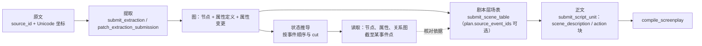

# 提取任务规范

提取任务的唯一规范页：模型该判什么（§4）、程序会拒绝什么（§5）、诊断码去哪查（§6）、
提示词怎么对应（§7）。搬运自 `docs/INVARIANTS.md`、`docs/data/PROPERTY_STATE_CONTRACT.md`、
`docs/data/PROPERTY_CATEGORIES.md` 与 `docs/MODEL.md` 第 2、3 节；措辞保持原文。

## 0 权威边界与变更纪律

- 本页是提取任务的唯一规范。概念定义以 `docs/MODEL.md` 为准，术语以 `docs/GLOSSARY.md` 为准，工具参数以 `docs/features/AGENT_API.md` 为准，三者不重复本文的规则条文。
- 编号：`M-xx` 模型判断规则、`E-xx` 提示词规范化出的硬约束、`I-xx` 程序强制的不变量、`G-xx` 术语。引用一律「编号 + 结论」。
- 改提取（提示词 / 校验 / 工具 / 诊断码）必须同批更新本页对应条目与 §7 的提示词版本表；`tests/test_extraction_spec.py` 会拦。

## 1 范围、引用与批次

- 范围：原文是唯一事实来源，引文须逐字命中原文（`I-13`）；章节标题、原文切片和提交批次只作阅读索引与处理范围，不决定场景或事件边界（`M-06`）。来源：本页 §4（原 `docs/MODEL.md` 第 2 节）与提取提示词「提取通用要求」v23。
- 引用：本页与其它文档一律按「编号 + 结论」引用（§0），编号集合与出处见 `docs/README.md`；五层概念见 `docs/MODEL.md` 第 1 节。
- 批次：一小批一次提交；本批引用 `@n` 从 1 起，数组索引从 0 起（见 §5「暂存、入库与编号」）；局部修补用 `patch_extraction_submission`（`I-28`）。

## 2 流程（读 → 提交 → staged → patch → accepted → 静态检查）

1. 读：agent 读取原文，原文是唯一事实来源（`I-13`、`I-16`）。来源：`docs/DEVELOPER_GUIDE.md` 第 3 节第 1 步。
2. 提交：`submit_extraction(source_id, result)`，草稿形状由 `RESULT_SCHEMA` 发布（`I-08`）。来源：同上第 2 步。
3. `staged`：草稿只被暂存，不是正式事实（`I-28`）。来源：同上第 3 步。
4. `patch`：`patch_extraction_submission` 局部修补，`expected_revision` 填 `submission_revision`，程序自动重检（`I-28`）。来源：同上第 5 步。
5. `accepted`：过检即原子入库，失败整体回滚（`I-27`）。来源：同上第 6 步。
6. 静态检查：入库后的自查由 `project_check` 提供（见 `docs/DEVELOPER_GUIDE.md` 第 1 节「验收与审计」）；状态推导在读取时发生（`I-30`、`I-31`，同上第 3 节第 7 步）。

## 3 模型职责（E-xx）

待 P2 填充。

## 4 模型判断规则（M-xx）

每条一到两句，都可判定。前缀编号用于引用。

**结构与边界**

- `M-01` 事件的边界看能否独立概括成一个情节，以及拿掉它前后情节是否仍成立；段落、章节、句子数、动词数都不作判据。
- `M-02` 场景的边界看现场是否还连续：空间仍接近、事件仍连贯。同一地点但隔了很久，或同一时刻换到远处，另起一场。
- `M-03` 大事件的边界看阶段是否换了：同一语境下连续的一大段进展，按披露顺序首尾相接。
- `M-04` 主要故事的边界就是部／卷本身：一部一条或拆成多条都可以，未完结也能创建，完成度由程序从下级证据派生。
- `M-05` 动作只在明确要求时提取；它直属恰好一个同语境事件，是最小包含层级。
- `M-06` 章节标题、原文切片和提交批次只作阅读索引与处理范围，边界仍按 `M-01`–`M-03` 判断。

**状态与属性**

- `M-07` 属性变更只写在事件处，操作取 `set`／`add`／`remove`／`clear`／`unknown`；前三者带值，后两者不带。
- `M-08` `scope` 决定这是谁的事实：`world` 是客观世界，`cognition` 是人物所知所信，`claim` 是言说主张；后两者用 `holder` 标明持有者，不覆盖 `world` 的取值。
- `M-09` 人物标量关系按对方对象分别维护；`many` 只表示一个数组集合。移除一个对方不清空其他关系。读取时列出当前有效的全部值。
- `M-10` 状态的答案是折叠结果而不是最后一条记录：同一事件同 `sequence` 的相容变更合并，不相容报冲突，不按记录 ID 猜测。
- `M-11` 读取某个事件点时得到的是截至该点的状态（读工具的 `cut`），不是全篇终态。

**证据与纠错**

- `M-12` 每条事实的引文必须逐字命中原文；定位与唯一性由程序校验，模型不手算坐标。
- `M-13` 事件默认给一条能支持身份与核心发生的代表性引文；引文数量不决定事件边界，属性与关系各自取证。
- `M-14` 复核只修有据错漏：没再提及不等于失效，冲突或一次攻击也不等于终止；确认终止时保留建立事实，在终止事件追加 `remove`／`clear`。
- `M-15` 两个疑似重复的事件是否同一次发生，看原文证据是否一致，同名或位置相近不作依据；先 `preview_event_merge`，再 `merge_events`。
- `M-16` 容器属性若与某个下属事件的属性同组（主体除外其余全同），以事件记录为准，容器写入被丢弃并回一条 `info`。

## 5 程序强制（I-xx）与属性状态合同

本表只收**程序真的会拒绝**的约束：每行的「校验点」是当前代码里的守卫函数，「诊断码」是它抛出的码，「覆盖测试」是断言它的用例。概念模型见 [叙事模型](../MODEL.md)（规则编号 `M-xx` 见本页 §4），术语见 [术语表](../GLOSSARY.md)；没有对应 `M-xx` 的行属于本页「硬约定」一节。提示词要求但程序不校验的，另列在[仅提示词约束](#仅提示词约束未程序强制靠验收与复核)一节，不混进本表。

判读方式：一条不变量成立与否只看「有没有违规数据能静默通过」。本表的行都要能指到具体函数与码，指不到的不写。

### 硬校验

| ID | 不变量（可判定的一句话） | 校验点（文件/函数） | 诊断码 | 覆盖测试 |
| --- | --- | --- | --- | --- |
| I-01 | 每个活动事件都必须在**自身事件处**记一条 `world` 地点状态：有效同语境 location 节点、显式「无」或「未知」 | `src/narrative/event_location.py::event_location_issues` | `EVENT_LOCATION_REQUIRED` | `tests/test_event_location.py` |
| I-02 | 地点状态只能锚定本事件，写在他事件处不能充当本事件地点 | 同上 | `EVENT_LOCATION_ANCHOR` | `tests/test_event_location.py` |
| I-03 | 有效地点值须是同语境、未撤回的 `location` 节点，或以 string/either 明确记录「无」「未知」；未知不能掩盖错值 | 同上 `_location_value_allowed` | `EVENT_LOCATION_VALUE` | `tests/test_event_location.py` |
| I-04 | 同一事件同一地点属性的变更互相冲突时报错，不按提交顺序挑一个 | 同上 | `EVENT_LOCATION_CONFLICT` | `tests/test_timeline_event_location.py` |
| I-05 | 每个活动物品必须有 `world` 持有状态（合法节点／「无」／「未知」）；失效或未记录不等于未知 | `src/narrative/item_possession.py::item_possession_issues` | `ITEM_HOLDER_REQUIRED` | `tests/test_item_possession.py` |
| I-06 | 持有者取值须为合法有效节点或显式「无」「未知」，认知 `holder_id` 不能顶替 | 同上 | `ITEM_HOLDER_VALUE` | `tests/test_item_possession.py` |
| I-07 | 同一事件位置的持有状态冲突不得择序 | 同上 | `ITEM_HOLDER_CONFLICT` | `tests/test_item_possession.py` |
| I-08 | 事件草稿必须带 `participants` 键；空数组表示「确无参与者」，缺键即拒 | `src/narrative/extraction.py::parse_nodes`（问题行 `path=["nodes",i,"participants"]`），`src/narrative/extraction_draft.py::submission_input_schema`（`allOf` 对 `type=event` 强制 required） | `EXTRACTION_CONTENT`，`DRAFT_SCHEMA` | `tests/test_extraction_diagnostic_paths.py`（参与者引用路径；缺键本身无专测） |
| I-09 | 容器（场景／大事件／主要故事）写入的属性若已由其下属事件按同组写过，该写入被丢弃并给 `info` 提示，事件记录胜出（`M-16`） | `src/narrative/property_core.py::container_property_duplicate`，`src/narrative/extraction.py::build_extraction` | `CONTAINER_PROPERTY_DEDUP` | `tests/test_container_property_dedup.py` |
| I-10 | 容器不落自身 `quotes`：容器证据只由已验证下级派生，提交里的容器引文被忽略 | `src/narrative/extraction.py::parse_nodes`（`is_container` 分支），`src/narrative/container_evidence.py::refresh_container_evidence` | 无错误码（静默丢弃） | `tests/test_extraction_container_evidence.py`，`tests/test_container_evidence_refresh.py` |
| I-11 | 进展属性只能落在直属子级：`storyline_progress` 记在 `big_event`，`big_event_progress` 记在 `scene` | `src/narrative/extraction.py::build_extraction`（`progress_owners`），`src/narrative/property_audit.py::audit_properties` | `progress_owner`（info） | `tests/test_storyline_contract.py` |
| I-12 | `world` 作用域不得带 `holder_id`；`claim`／`cognition` 必须带人物节点 `holder_id`（`M-08`） | `src/narrative/property_core.py::validate_records` | `SCOPE` | 无直接用例（同函数其余分支见 `tests/test_current_state_contract.py`） |
| I-13 | 引文必须**逐字**且**唯一**匹配原文；同一句多处出现时用合法 `disclosure.start` 消歧（`M-12`） | `src/narrative/property_core.py::_evidence_error`，`src/narrative/property_operations.py::record_change` | `EVIDENCE` | `tests/test_source_location_contract.py` |
| I-14 | `evidence` 只允许 `source_id` 与逐字 `quote` 两个键 | `src/narrative/property_core.py::_evidence_error` | `EVIDENCE` | `tests/test_current_state_contract.py` |
| I-15 | `disclosure` 须为合法原文 Unicode 坐标，且与引文起点逐字对齐 | `src/narrative/property_core.py::validate_records` | `DISCLOSURE` | `tests/test_project_check_locations.py` |
| I-16 | 节点证据引文须是原文子串，跨度须与原文位置相符（`M-12`） | `src/narrative/graph_service.py::precheck` | `EVIDENCE`，`EVIDENCE_SPAN` | `tests/test_project_check.py` |
| I-17 | 属性记录 ID 非空且唯一、`kind` 只能是 `property_definition`／`property_change`、字段走白名单 | `src/narrative/property_core.py::validate_records` | `ID`，`KIND`，`FORMAT` | `tests/test_current_state_contract.py` |
| I-18 | 变更必须锚定有效事件或动作，`sequence` 为非负整数，语境必须存在 | 同上 | `EVENT_REF`，`SEQUENCE`，`CONTEXT` | `tests/test_event_property_state.py` |
| I-19 | `clear`／`unknown` 不得携带 `value`；many 集合元素唯一、节点引用有效（`M-07`）。这是**写入**约束，不描述查询形状 | 同上 | `VALUE` | `tests/test_current_state_contract.py` |
| I-20 | 值类型与定义一致；`target_node_types` 只用于 `node` 定义；`symmetric` 为严格布尔；`one`／`many` 是**录入规则**（`one` 同一事件点只允许一个当前值，`many` 允许并存）与「标量关系按对方分别维护」（`M-09`），**不决定查询形状**——`state()`／`property_state()` 的 `known` 一律返回 `values` 列表，单值也是长度 1 的列表 | 同上 | `DEFINITION`，`VALUE` | `tests/test_property_symmetry.py`，`tests/test_state_values_contract.py` |
| I-21 | 五层直属关系：`scene→big_event→storyline`、`event→scene`、`action→event`，不跳层 | `src/narrative/extraction_draft.py::_draft_input_diagnostics`（`expected_parent` 映射），`src/narrative/storyline_ranges.py::analyze`，`src/narrative/graph_service.py::precheck` | `STORYLINE_CHILD_TYPE`，`COMPOSITE` | `tests/test_adaptation_hierarchy_contract.py` |
| I-22 | 每个活动事件必须经包含路径归属同语境的活动场景 | `src/narrative/containment_refs.py::event_scene_issues` | `EVENT_SCENE` | `tests/test_project_check.py` |
| I-23 | 动作必须直属恰好一个同语境活动事件，且不能含子项（`M-05`） | 同上 | `ACTION_EVENT`，`ACTION_LEAF` | `tests/test_granularity_actions.py` |
| I-24 | 包含关系不得成环 | 同上 | `CONTAINMENT_CYCLE` | `tests/test_project_check.py` |
| I-25 | 只有事件与动作能记参与者，且参与者须是人物／群体节点：地点用事件自身的地点属性、物品用持有者属性 | `src/narrative/graph_service.py::precheck`（存储写入），`src/narrative/extraction.py::parse_nodes`／`src/narrative/extraction_refs.py::References.resolve`（提取草稿） | `PARTICIPANTS` | `tests/test_item_possession.py`，`tests/test_extraction_diagnostic_paths.py` |
| I-26 | 只有事件记录 `predecessors`／`successors`，只能指向事件且不能指向自己 | 同上 | `EVENT_CHAIN` | `tests/test_current_state_contract.py` |
| I-27 | 正式资料版本必须等于提交携带的 `expected_revision`，否则整批拒绝 | `src/narrative/graph_service.py::precheck`，`src/narrative/graph_operations.py`（各写入口的 `expected_revision`） | `REVISION` | `tests/test_current_state_contract.py`，`tests/test_extraction_staging.py` |
| I-28 | 提取草稿未过预检时只返回 `staged` 与问题行，不写正式事实；过检即原子入库，不留半套写入 | `src/narrative/extraction_staging.py::submit`／`patch`／`_evaluate` | 状态 `staged`（无错误码） | `tests/test_extraction_staging.py` |
| I-29 | 回滚保留回滚点、删除其后的变更并清理引用，不重放节点旧版本 | `src/narrative/temporal_state.py::rollback`，`src/narrative/graph_operations.py::rollback_to` | 无错误码（`status=rejected` 时返回问题报告） | `tests/test_current_state_contract.py` |
| I-30 | 状态推导按 `(node_id, property_id, context_id, scope, holder_id)` 分组，不同组不得混算（`M-10`） | `src/narrative/property_core.py::change_group`／`reduce_changes` | `STATE_GROUP` | `tests/test_current_state_contract.py` |
| I-31 | 同一事件同一 `sequence` 的不相容变更报冲突，不按记录 ID 或提交顺序猜测（`M-10`） | `src/narrative/property_core.py::reduce_changes` | `STATE_CONFLICT` | `tests/test_event_property_state.py` |
| I-32 | 已登记的阅读顺序不可改写；`canon` 与故事时间轴标识不可修订 | `src/narrative/graph_service.py::precheck` | `SOURCE_ORDER_IMMUTABLE`，`INFRA_IMMUTABLE` | `tests/test_current_state_contract.py` |
| I-33 | 主要故事的完成边界须给出正式原文坐标并晚于所属成员起点，且成员不得跨出已完成区间；空候选批次整批拒绝（`M-04`） | `src/narrative/storyline_ranges.py::analyze`，`src/narrative/graph_service.py::precheck` | `STORYLINE_COMPLETION`，`STORYLINE_POSITION`，`STORYLINE_OVERLAP`，`EMPTY` | `tests/test_storyline_contract.py` |

### 硬约定

以下条目都有真实校验，违反时返回诊断码或跳过原因。

**事件地点**：每个活动事件必须在自身事件处记录 `world` 地点，主体与 `at_event` 都指向该事件。

| 诊断码 | 触发 |
| --- | --- |
| `EVENT_LOCATION_REQUIRED` | 事件没有自己的 `world` 地点，或清空、移除后未重新记为无／未知 |
| `EVENT_LOCATION_ANCHOR` | 地点变更锚在别的事件上 |
| `EVENT_LOCATION_VALUE` | 值既不是同语境 `location` 节点，也不是显式的无／未知 |
| `EVENT_LOCATION_CONFLICT` | 同一事件点出现不相容的地点状态 |

**参与者与持有者**

- 事件草稿必须带 `participants` 键：`allOf` 对 `type=event` 强制 `required`，缺键返回 `EXTRACTION_CONTENT`。确无参与者或原文未交代时给空数组。
- 每个活动物品必须有 `world` 持有状态（节点引用、无、未知），缺失或清除不等于未知：`ITEM_HOLDER_REQUIRED`。

**结构与进展属性**

| 诊断码 | 触发 |
| --- | --- |
| `EVENT_SCENE` | 活动事件没有经包含路径属于同语境的活动场景 |
| `ACTION_EVENT` | 动作不是恰好直属一个同语境事件（直接挂场景或大事件） |
| `ACTION_LEAF` | 动作包含子项 |
| `STORYLINE_CHILD_TYPE` | 层级跳级，例如主要故事直属事件 |
| `STORYLINE_POSITION` | 容器没有可定位的直属成员，无法确定阅读起点 |
| `STORYLINE_OVERLAP` | 成员跨出已完成主要故事的区间，或与下一区间重叠 |
| `STORYLINE_COMPLETION` | 主要故事的完成边界缺失，或早于所属成员的起点 |

`storyline_progress` 写在直属大事件上，`big_event_progress` 写在直属场景上；写到更上层时该条写入被跳过（结果里的 `skipped` 附原因），程序不迁移旧层级。

**属性记录与状态推导**

- `property_change` 必带 `node_id`、`property_id`、`event_id`、`op`、`sequence`；`sequence` 由程序按引文起点生成，模型自带 `sequence` 会按 `DRAFT_SCHEMA` 拒收。
- 折叠失败码：`STATE_CONFLICT`（同事件同序号不相容）、`EVENT_ORDER`（变更缺少正式顺序）、`SEQUENCE`（序号非法）、`STATE_GROUP`（跨分组）、`VALUE`（关系值不是单一有效对方）。
- 证据问题用 `EVIDENCE`，草稿形状用 `DRAFT_SCHEMA`。

**暂存、入库与编号**

- 返回 `staged` 表示草稿只被暂存、未写入正式事实；修补用 `patch_extraction_submission`，`expected_revision` 填 `submission_revision`。通过后返回 `accepted` 或 `unchanged`。
- `info` 不是必须清零的错误：容器属性判重（`CONTAINER_PROPERTY_DEDUP`，附 `duplicate_of`）即 `info`。
- 本批引用 `@n` 从 1 起，数组索引从 0 起。
- 合并事件用 `source_event_id`（并入方）、`target_event_id`（保留方）、`expected_revision`、`evidence`、`reason`；合并后不保留重定向或旧修订对象。

### 数据流

场表与正文是可选的消费层：`source_event_ids` 不填不阻止写作；生成结束后程序区分 `used_event_ids`、`unused_event_ids`、`unknown_event_ids`，未绑定部分不冒充已使用。

### 属性状态合同（schema 11）

属性不保存有效期。只保存当前定义和事件处的变更，由程序按事件顺序推导状态；不恢复人工接受、撤回链或数据库修订重放。

| 记录 | 字段 |
| --- | --- |
| `property_definition` | `id`、`value_type`、`cardinality`，可选 `target_node_types`、`semantic`、`symmetric` |
| `property_change` | `id`、`node_id`、`property_id`、`event_id`、`sequence`、`op`，以及按操作填写的 `value`、作用域、认知持有人、语境、证据与分类 |

操作为 `set`（建立或设为）、`add`（增加）、`remove`（移除）、`clear`（失效整组）、`unknown`（明确未知）。前三者需要值；后两者不带值。集合值使用数组；人际标量关系按对方分别维护，移除某一对方不会清除其他关系，不能为了移除一个对象使用 `clear`。

提取按正式原文顺序和事件 Unicode 披露位置排列事件，同事件按非负整数 `sequence` 排列。提取的序号由程序使用定位引文的起点生成，不让模型手算；人工新增由操作明确追加序号，更正保留原序。不同批次、记录 ID 和写入时间都不决定先后。同事件同序号的不相容操作报告冲突，不能任意挑选一个。

读取某事件默认包含该事件全部变更；精确读取可指定事件内序号。改编和剧本使用独立时间线的 `sort_id`，共用同一纯推导器。部分导入保留相关实体的必要前序状态锚点，但不带入未选剧情正文或未来变化。

派生状态区分 `known`、`unknown`、`absent`、`unrecorded` 和 `conflict`；贡献变更、来源与历史可查。未知基线上的集合增删不能假称知道完整集合。物品须有明确世界事实持有状态：有效节点、“无”或明确未知操作；清除、未记录与认知持有人都不能替代。

每个活动 `event` 必须在自身事件处记录 `world` 地点，主体和 `event_id` 都指向该事件。地点可引用活动 `location` 节点，或显式填写“无”“未知”，也可用 `op=unknown` 且不携带值。新地点定义建议用 `either`；已使用 `node` 的定义可继续引用地点节点。未交代地点时应由提交者明确记录未知，程序不自动填充。清除、删除或遗漏记录不能替代未知，认知/言说中的地点及上层场景地点也不能替代。原作、改编和剧本时间线共用这一静态规则；不自动修改已有数据，旧结果的遗漏会显示诊断。

剧情变化追加变更；错录通过 `correct_property` 更正原记录或物理删除，不追加虚假剧情。回退删除边界后的变更与节点、清理引用，再推导状态，不修改更早记录以“开放终点”。定义更名或合并物理重写类型化引用，不保留别名链。

所有写入通过 Operations 做静态校验、证据与引用检查、并发检查和原子入库审计。仅支持 schema 11，旧格式明确拒绝，不提供兼容、迁移或自动清空原件。

### 属性分类（schema 11）

分类只决定取值在浏览页显示在哪个方面，不改变事实、事件顺序或逐字证据。`scope` 与分类独立：world 是世界事实，cognition / claim 分别表达人物认知或声称，并指定 `holder_id`。

分类保存在 `property_change.category`，提取草稿里它是必填项：填该节点类型分类表里的一个大类，或显式填「未分类」。移动分类通过 `Operations.property_categorize` 直接编辑所选取值的当前字段；不追加分类日志、撤回记录或别名映射。工程分类词表保存在工程配置，按对象类型提供默认分组，「未分类」是词表末项，也是唯一的人工「暂不归类」选项。

分类只来自显式值，程序不做任何推断：不按属性名猜（「身高」不再自动落到「外貌」），也不按取值猜。已保存的记录里没有 `category` 的（旧工程或手工写入），读取时显示为「未分类」，`category_source` 为 `default_unclassified`；有显式值的记录为 `explicit`。程序不会自动补写分类，也不会批量回填——要归类就在浏览页用 `property_categorize` 手动选，或显式保留未分类。

分类不在当前词表里时，静态检查报 `category_unknown`（warning），不影响取值；完全未分类的记录由 `category_unassigned` 汇总成一条工程级提示（「N 条属性未分类」），没有可跳转的具体对象。

事件和动作通过地点属性引用 `location` 节点时，该属性归入“基本信息”；地点仍是原文证据支持的节点引用，不推断缺失的地点。

关系的 `property_id` 表达具体关系性质，`category=关系` 只是显示分组。物品的持有者语义由定义 `semantic=item_holder` 标识，不能用分类名、认知持有人或含有“归属”的任意词句代替。

所有编辑通过 Operations 的静态校验和轻量动作审计；完整合同见 [数据模型](../data/DATA_MODEL.md) 与 [属性状态合同](#属性状态合同schema-11)。

### 仅提示词约束（未程序强制，靠验收与复核）

下面这些写在提取提示词（`src/narrative/prompt_defaults.py`，条目「提取通用要求」v23、「标准/精细提取粒度」v6）里，程序**没有**对应的拒绝路径：只能靠模型自检、真实模型验收与人工复核判断，不能当成已校验的保证。

| 约束 | 提示词出处 | 程序侧现状 |
| --- | --- | --- |
| 事件边界靠语义判断，不按动词、句子、数量或比例配额机械切分 | 「精细提取粒度」自检句 | 无校验：程序只查层级、引文与引用合法性 |
| 事件默认只提交一条足以证明其身份的代表性引文，不为起因过程结果分别罗列 | 「提取通用要求」 | 只要求引文非空且在范围内唯一，不限制条数上限 |
| 动作默认不提取，仅在用户明确要求时提取；不得把动作改标成事件 | 「标准提取粒度」「精细提取粒度」 | 无校验：`action` 与 `event` 走同一套结构校验 |
| 场景边界判据是「现场是否还连续」，地点只在事件上记，场景不按章节／切片／批次切 | 「提取通用要求」 | 只校验 `event→scene` 归属与同语境，不校验边界是否合理 |
| 次要人物、无名人物与具体地点须查全，不臆造身份、不拆重复实体 | 「精细提取粒度」 | 只校验参与者节点类型与引用有效性 |
| 主要故事的范围终点取下级证据派生的 `completion`，不以章节或批次结束代替语义闭合 | 「提取通用要求」 | 只校验 `completion` 不越出原文范围，不判断「是否真的完结」 |

改提示词时同步升该条 `version`，并按 [提示词写作风格](../PROMPT_STYLE.md) 用要点断言；本表「硬校验」一节的码是防漂移测试 `tests/test_doc_consistency.py` 的锚点，新增码要同时在代码与本表出现。

## 6 诊断码总表

待 P3 填充。

## 7 提示词索引

待 P2/P3 填充。
