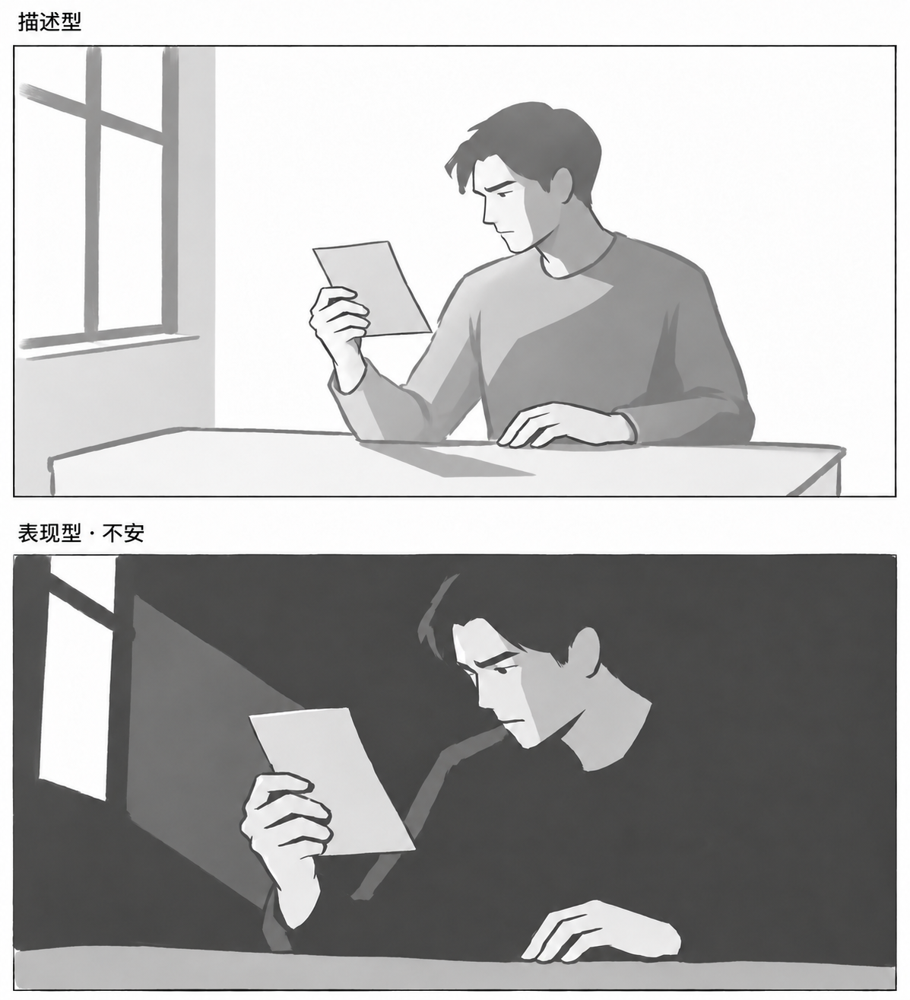
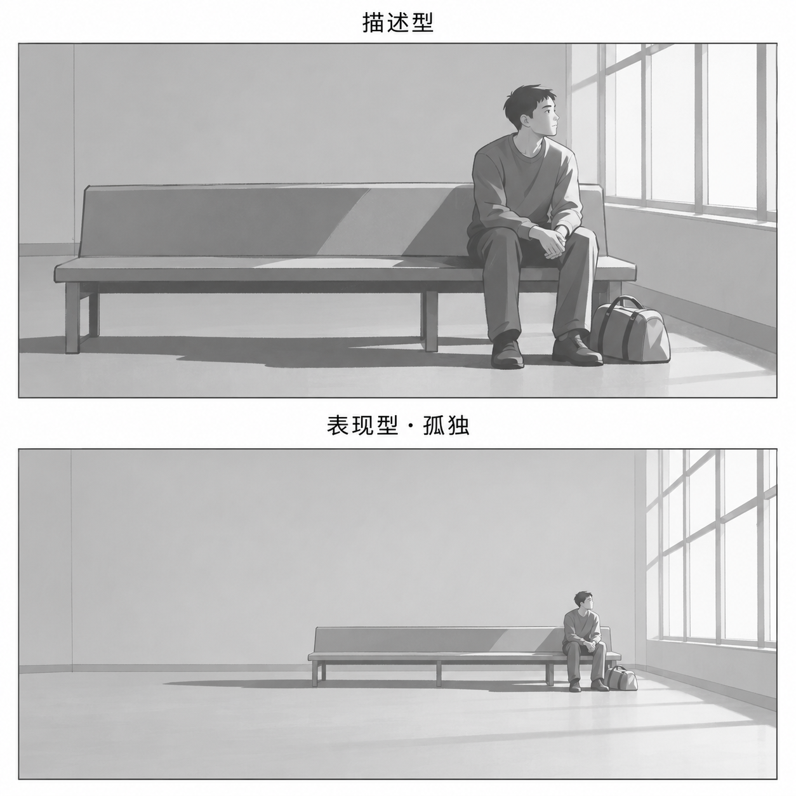
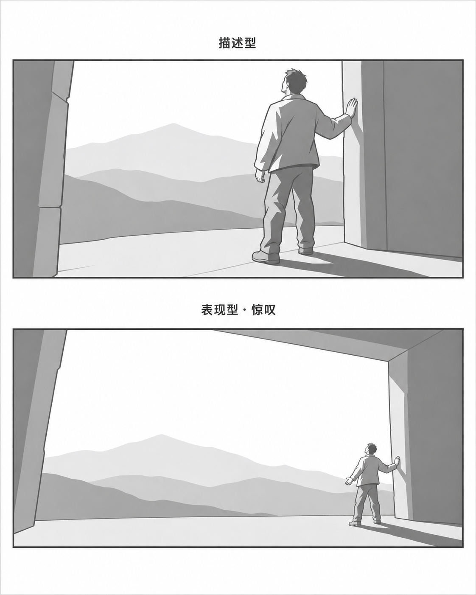
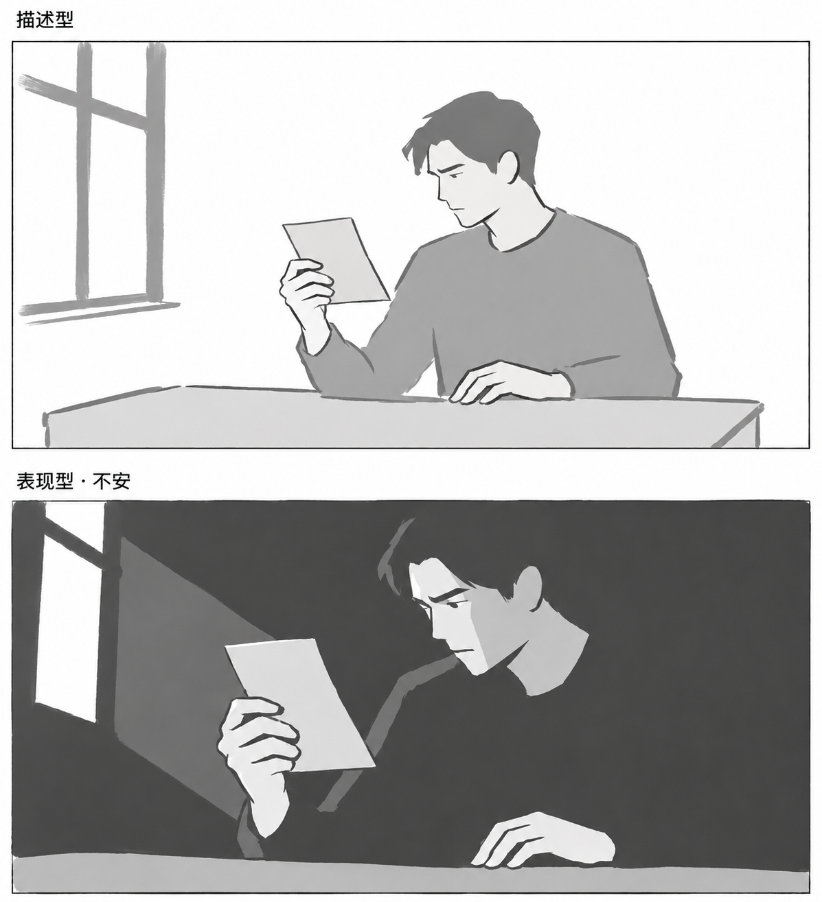

# 描述型素描：本项目分镜图稿的画法

这份文档定的是**图**怎么画。分镜稿的文字部分由协作者直接写，不在本文范围内；资产提供的是什么，见[资产需求标准](ASSET_STANDARD.md)。

素描在流程里的位置是**快速预览**：排镜时先把画面画出来，看节奏、看调度、看光线落在哪；确认之后，只把挑中的那些画格转成项目风格关键帧。所以素描要快要省，但**不能省掉光照**——一张没有光照的素描，转成关键帧时没有依据可继承。

本项目的素描只有**描述型**一种。指南里的表现型（用构图、明暗、尺度主动制造情绪）可以作为个别镜头的处理手段，但它不是本项目的默认画法，也不是判断标准。

图例与规范来自《AI影视分镜素描风格与制作指南》，见文末来源。

## 共同要求

**先让事件与空间可读。** 人物重心、身体朝向、视线、手与道具的接触要明确；用必要的遮挡和空间边线交代前后关系，避免物体恰好相切而产生歧义。

**光照要在主体上产生结果。** 窗、灯、太阳的位置只是照明条件，画面要让人看到这套光**落在物体上**的结果：同一形体的受光与背光、必要的投影、接触暗部。画外光源也可以成立，只要结果可读、与镜头说明一致。

**按实际照明选择信息。** 柔和正面光、阴天或高调画面可能没有鲜明投影，不必为了“有光照”强加硬阴影，用较弱的体面转折和亮度层次表达即可。多光源时说明各自方向与作用，不要自相矛盾。

**区分三种灰。** 深衣服的固有深浅、光照造成的阴影、为构图刻意压低的区域，含义完全不同。灰阶不决定颜色与色温：**不要从灰阶猜颜色**，需要颜色就在简彩版里显式指定。

## 描述型的画法

自然、清楚、节制。用简洁形体交代动作和空间，用概括的明暗保留照明，用细节分配确定观看重点。

1. 明确这一镜要让观众知道什么，定画幅、景别与取景；
2. 放置主体与关键道具，核对重心、视线、接触和重要遮挡；
3. 确定光向与照明性质，先归纳主要受光区域和连贯暗部；
4. 加必要投影与少量接触暗部，再补承担情节的局部；
5. 删掉重复轮廓、细碎衣褶与装饰纹理，检查删减是否损害光照或动作。

线条用轮廓加少量转折线界定动作，非重点边缘可以减弱或省略。明暗用大块面组织体积，不给所有物体套同一种渐变；受光面与背光面可以简化，但朝向要能解释。边缘软硬服从形体与光照，不必全部描成同样粗重的黑线。

## 最容易犯的错：有灰度，没有光照

这是指南点明的最重要修正，也是本项目最常见的退步方式——按头发、衣服、皮肤的固有深浅分别填色，看上去有层次，但侧光并没有作用在主体上。

| | 错的样子 | 对的样子 |
|---|---|---|
| 依据 | 物体是什么颜色 | 光从哪来、挡在哪 |
| 结果 | 每个物体一块平灰 | 同一形体左亮右暗，桌面有延伸投影 |
| 修法 | —— | 先核对光向，再恢复大块受光/背光，最后补投影与接触暗部 |

修正时不要靠增加表面细节掩盖光照问题：**先解释光，再谈质感**。

## 交付前的检查

1. **事件可读**：缩小观看仍能辨认主体在做什么；
2. **接触可靠**：手与道具、身体与支撑物没有悬空、相切或前后颠倒；
3. **光照成立**：主要明暗能由受光和遮挡解释，不是按物体平涂；
4. **阴影一致**：形体暗面、投影与说明支持同一套照明，软光没有被强加硬影；
5. **省略明确**：未展开、有意安静、确实空无的区域互相区分；
6. **表达落实**：遮掉情绪文字后，画面仍呈现预定的尺度、距离或明暗关系；
7. **衔接连贯**：视线、运动方向、道具持握、站位与光照的前后变化都有依据；
8. **转换保真**：与风格关键帧并置后，构图、动作、光影和观看顺序得到保留。

## 生成指令模板

每次生成先写清事件、镜头与光照，再补画面类型：

> 生成一张用于后续项目风格关键帧的工作素描。画幅为〔画幅〕，景别与视角为〔镜头〕。主体〔角色或对象〕正在〔明确动作阶段〕，与〔道具或环境〕保持〔接触与空间关系〕。观看重点依次为〔重点一〕和〔重点二〕。主光来自〔方向或来源〕，照明为〔软硬与整体倾向〕；用主要形体的受光与背光及必要投影说明光照。线条和灰阶简洁，非重点区域概括。

描述型追加：

> 以自然、清楚、节制的方式交代事件。准确表现姿态、视线、体积和遮挡。将明暗归纳成少量相互关联的大块面，保留光向、主要形体转折、必要投影和接触暗部。角色与道具的细节只保留到足以表达本镜重点；服装纹理、装饰和非关键陈设交由项目资产补充。

只修光照时：

> 保留现有构图、姿态、道具及简洁程度，仅修复光照信息。依据〔光向〕补回〔主要受光与背光区域〕，并在〔位置〕增加必要投影或接触暗部。保持非重点区域的概括，不增加材质纹理、细碎衣褶或肖像细节。

## 图例

**读信。** 上为描述型：左侧窗光在面部、肩臂和桌面产生可见结果，桌面向右留下概括投影。下为表现型：同一事件，靠取景收紧与明暗面积制造不安。描述型已恢复光照信息，是默认画法；表现型只在个别镜头按需使用。

**候车。** 两幅都保留右侧窗光。下方拉远后，空座位与未占据的空间成为叙事信息——孤立感来自尺度、空位与距离，不需要压暗画面。

**山谷。** 门洞、手与门框的接触、观看方向建立动作；环境的整体尺度承担表达，山体细节保持概括。日光从前左照入，人物、门洞与地面以同一光照关系连接。

**光照丢失（修正前）。** 衣服、头发、皮肤各有深浅，但这些深浅主要在区分物体，侧窗光没有在主体上充分体现。对照第一张图的描述型，就是本项目要避免的状态。

## 来源

《AI影视分镜素描风格与制作指南》（描述型与表现型的画面规范，2026-11-04）。本文只取描述型与共用要求；表现型的具体手段、以及指南中的示例转关键帧步骤，按需查阅原件。
